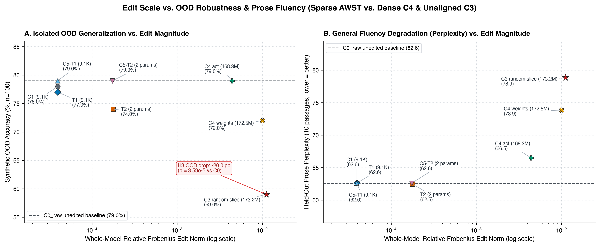

# Agentic Weight-Space Transplantation on Language Models

**Primary Investigator:** Kaiwen Du (College of Arts and Sciences, Santa Clara University) · November 27, 2026  
**Repository State:** Freeze commit `d12e8fb` (M3 evaluation `42b859b`, `H004` review `9c975e9`, Milestone M4)

> **Academic Research Scope Disclaimer:** This study is a non-commercial academic feasibility investigation operating exclusively on open-weight Apache-2.0 checkpoints (`Qwen/Qwen3.5-0.8B` and `Qwen/Qwen3.5-2B`). It does not perform knowledge distillation or develop models intended to compete with frontier model providers; automated editors operate strictly between pinned open-weight checkpoints.

---

## Abstract

Recent work shows that AI agents can inspect a language model's weights and make targeted edits without training. We test whether an agent can go further and *transplant* a learned capability from a larger donor model (`Qwen/Qwen3.5-2B`) into a smaller, fixed-architecture recipient (`Qwen/Qwen3.5-0.8B`) with zero gradient updates.

In this preregistered feasibility study targeting grade-school math, we compare two separate approaches: a **weights-only** track (`T1`, no donor forward passes) and an **activation-assisted** track (`T2`, bounded donor probing). We evaluate both against unedited, donor-free, random, conventional algorithmic, and shuffled-donor controls under a loop-free evaluation protocol. On isolated held-out benchmarks (GSM8K, synthetic arithmetic, and out-of-distribution templates), neither frozen single-session edit met our preregistered success criteria. `T1` (editing 10 digit embeddings) reached 54.5% on GSM8K versus 51.5% for the unedited model (`p = 0.345`) and did not outperform donor-free or shuffled-donor controls; `T2` (editing 2 Gated DeltaNet decay scalars) stayed at 51.5% (`p = 1.000`) and dropped on out-of-distribution items. In contrast, unaligned donor copying caused a sharp 20-point out-of-distribution collapse and worse prose perplexity, whereas aligned or sparse edits avoided this damage. We also verify bit-exact selective weight fetching over HTTP 206 byte-range requests (a 9,893x reduction in downloaded bytes). Following the negative Stage 1 outcome, later cross-family stages were formally skipped; our findings show that these single-session strategies fall short of genuine math transfer, without ruling out future multi-session or denser methods.

---

## 1. Introduction

Transferring specialized capabilities from large pretrained language models into compact on-device models ordinarily requires gradient-based fine-tuning, knowledge distillation, or large-scale activation-driven pruning and merging [@fan2026apm; @cui2026transport]. Recent work on **Weight-Space Programming (WSP)** demonstrates that frontier reasoning models can directly inspect serialized weight matrices, write interpretable weight programs, and execute surgical parameter edits that alter downstream behavior [@takehi2026sparks; @li2026weightcode]. In the motivating case study, Takehi et al. [@takehi2026sparks] reported raising `Qwen3.5-0.8B` GSM8K accuracy from `13.8%` to `67.1%` by subtracting a single vector direction across `131,072` MLP entries (`0.016%` of parameters).

Yet single-model WSP repairs primarily *unblock* latent capabilities by suppressing repetitive reasoning loops rather than importing missing circuits [@takehi2026sparks]. Moreover, follow-up replication work warns that frontier LLMs succeed most reliably when reading or writing shallow input-layer representations rather than deep internal algorithms [@goworek2026replicating], and that standard empirically risk-minimized (ERM) checkpoints are often brittle under direct weight perturbation unless trained specifically for editability [@ropinski2026editready]. Whether an autonomous AI programmer can extend WSP across model boundaries—identifying a stronger capability in a larger *donor* checkpoint, resolving hidden-dimension and basis mismatches, and transplanting that capability into a *recipient* without gradient descent—remains untested under rigorous controls.

We formulate **Agentic Weight-Space Transplantation (AWST)** and investigate six research questions:

- **RQ1 (Primary feasibility):** Can an AI agent selectively identify, adapt, and transplant grade-school mathematical reasoning from a larger donor (`Qwen/Qwen3.5-2B`) into a smaller fixed-architecture recipient (`Qwen/Qwen3.5-0.8B`) without gradient-based training?
- **RQ2 (Agent vs. algorithm):** Does agent-directed transplantation (`T1`, `T2`) outperform matched conventional algorithmic transfer (`C4_weights`, `C4_act`)?
- **RQ3 (Donor vs. self-repair):** Does donor access outperform donor-free agent weight editing of the recipient alone (`C1`)?
- **RQ4 (Cross-family generalization, gated):** Can AWST transfer across distinct model families (`Qwen3.5-9B -> Gemma 4 E2B`)? *(Formally skipped under Decision `D011` after Stage 1 failed gate criteria.)*
- **RQ5 (Selective remote weight access):** Can bounded HTTP `206` range retrieval read and verify target donor slices without downloading full multi-gigabyte shards?
- **RQ6 (Exploratory agent comparison):** How do permitted harnesses (`GPT-6.2 Astra` vs. `Gemini 4 Neon`) compare on a controlled synthetic weight-space competency suite?

These questions map to a primary hypothesis (`H1`: `T1` or `T2` outperforms both `C1` and `C4` while meeting `>= +5 pp` gain over `C0_raw`, donor dependence over `C5`, OOD transfer, `<= 3 pp` retention loss, and unchanged architecture), competing against the null (`H0`), alongside secondary hypotheses testing unseen/non-loop generalization (`H2`), alignment against unaligned copying (`H3`), and byte-reduced selective remote access (`H4`).

**Contributions and Honest Scoping.** This study provides: (1) a preregistered experimental and statistical protocol separating weights-only (`T1`) and activation-assisted (`T2`) AWST tracks from reasoning-loop confounds, matched controls (`C0`–`C5`), and external hidden test sets; (2) an empirical Stage 1 evaluation showing that neither frozen `T1` (10 tied digit embeddings via ridge anchor mapping) nor `T2` (2 Gated DeltaNet decay scalars via activation routing and ablation) improved held-out math performance over unedited or shuffled-donor controls, exposing a sharp development-to-validation generalization mirage; (3) evidence confirming partial hypotheses `H3` (unaligned `C3` suffers `-20.0 pp` OOD and `+16.2` perplexity collapse) and `H4` (`9,892.98x` byte reduction via verified HTTP `206` reads); and (4) an open, auditable failure analysis incorporating an independent `H004` statistical review (`runs/codex_h004/review.md`). Because Stage 1 evaluated one frozen session (`N=1`) per agent track and Stages 2–4 were stopped cleanly at the Stage 2 gate (`D011`), our findings provide negative feasibility evidence for these concrete single-session AWST strategies rather than proving impossibility across all future multi-session or dense subspace methods.

---

## 2. Related Work

**Weight-Space Programming and Verification.** Takehi et al. [@takehi2026sparks] introduced Weight-Space Programming (WSP), showing GPT-6 Astra could write small policy networks and locate loop-inducing MLP directions in `Qwen3.5-0.8B` via bounded slice inspection and development forward passes, while noting cross-model circuit grafting as future work. Concurrent studies sharpen both the promise and boundaries of WSP. *WeightCode* [@li2026weightcode] shows LLMs can synthesize reusable closed-form weight-editing programs conditioned on task demonstrations, though cross-seed transfer was examined only within identical architectures. Goworek et al. [@goworek2026replicating] replicate WSP on synthetic tasks and show that LLM weight reading relies heavily on decoding input-layer weight patterns rather than mechanistic comprehension of deeper circuits—a direct warning for weights-only transplantation (`T1`). Ropinski and Kranz [@ropinski2026editready] find that standard ERM vision networks resist direct LLM edits unless pretrained with *Edit-Ready Training*, and Gross [@gross2026wspverify] combines WSP with formal verification to detect policy regressions. AWST operationalizes non-training verification via bit-exact structural invariants, `float64` reversion tests, and held-out retention suites.

**Training-Free Model Merging and Cross-Scale Transfer.** Independently trained networks occupy distinct coordinate bases and permutation symmetries, causing naive averaging or index-matched slicing to degrade performance unless neurons are aligned by weights or activations, as shown in *Git Re-Basin* [@ainsworth2023gitrebasin] and *ZipIt!* [@stoica2024zipit]. Extending to heterogeneous widths and architectures without gradient training, *Activation-Prune-Merge (APM)* [@fan2026apm] prunes salient donor dimensions from task-conditioned activation maps and merges them into smaller recipients, while *Transport and Merge* [@cui2026transport] computes neuron correspondences across distinct architectures via Optimal Transport over calibration activations. Consequently, training-free cross-scale transfer is not novel by itself; rather, AWST tests whether *agent-directed* inspection and closed-form adaptation can match or surpass algorithmic alignment baselines (`C4`) while preserving donor-specific utility (`T1/T2 > C5`).

**Safetensors Remote Metadata Parsing.** Hugging Face [@huggingface2026safetensors] documents inspecting Safetensors tensor headers via HTTP `Range` requests (`bytes=0-7` length prefix followed by JSON metadata). AWST evaluates whether exact HTTP `206` byte-range fetching can materialize isolated weight tensors cleanly (`H4`) without downloading entire multi-gigabyte checkpoints.

---

## 3. Method

### 3.1 Operational Definitions and Track Separation

Following our frozen protocol (`AWST_Research_Protocol_v0.3.md` §4), we define the components of AWST cleanly:

- **Donor (`Qwen/Qwen3.5-2B`):** Pretrained open-weight checkpoint demonstrating superior mathematical reasoning (`+21.5 pp` isolated GSM8K lead over recipient).
- **Recipient (`Qwen/Qwen3.5-0.8B`):** Smaller fixed-architecture checkpoint whose existing parameter tensors may be updated in-place into derived directories without changing parameter count (`873,438,784` stored entries), tensor shapes, layer count (`24` text layers), tokenizer, or runtime graph, and with `0` gradient/backpropagation steps.
- **Weights-Only Track (`T1`):** The editing agent may inspect donor and recipient checkpoint metadata, statistics, and bounded tensor slices (`<= 200 MB` payload cap) and run recipient forward passes on `data/development/`, but **zero donor forward passes** (`donor_forward_passes = 0`).
- **Activation-Assisted Track (`T2`):** A strictly unpooled track permitting bounded donor forward passes (`<= 64` prompts) on `data/development/` alongside weight inspection. Tracks `T1` and `T2` are logged under separate manifests (`H002`, `H003`), run in distinct Codex sessions, and analyzed against track-matched controls (`C4_weights` vs. `C4_act`).

### 3.2 Agent Interface and Immutable Provenance

Agents operate through a bounded Python toolbox (`src/agent_interface/tools.py`: `AgentWeightToolbox`) enforcing byte-read budgets, forward-pass counters, and tensor-size limits so raw multi-million-entry matrices are never serialized into prompt context. Every patch goes through `apply_tensor_patches` (`src/interventions/patch_applier.py`), writing derived `.safetensors` shards without mutating cached donor or recipient checkpoints, verifying exact total parameter counts, dtype preservation, and bit-exact SHA-256 invariance across all `153` multimodal vision tensors (`model.visual.*` / `visual.*`, per `D003`). Independent verification scripts (`verify_h002.py`, `verify_h003.py`) further enforce full-shard deterministic CLI replay and `float64` delta subtraction restoring the pristine recipient shard SHA-256 with zero differing parameters.

### 3.3 Implemented Interventions and Control Arms

All 10 arms evaluated in M3 (plus `C2` validation reference and `C0_loopfixed` Stage 0 reference) are deterministic functions of pinned checkpoints and `data/development/`:

1. **`C0_raw` (Unmodified Recipient):** Pinned `Qwen/Qwen3.5-0.8B` (`2fc06364...`) evaluated without modification. Stage 0 also verified `C0_loopfixed`, applying Takehi et al.'s `p50c` direction across `130,188` `bfloat16` entries in layers 15 and 19 `mlp.down_proj.weight` (`rel_frob = 0.002379`).
2. **`C1` (Donor-Free Agent WSP, `H002`):** Edits strictly the 10 individual ASCII digit rows (token IDs `15`–`24`, corresponding to `'0'`–`'9'`) in `model.language_model.embed_tokens.weight` (tied to LM head) to expand between-digit contrast away from the 10-digit centroid: letting $R \in \mathbb{R}^{10 \times 1024}$ denote the digit rows and $Z = R - \bar{R}$, `C1` writes $\text{BF16}(R + a Z)$ with screen-selected radius $a = 1/32$ chosen prior to opening any donor tensor (`9,097` changed entries, overall relative Frobenius norm `3.961e-5`).
3. **`T1` (Weights-Only AWST, `H002`):** Inspects only the 10 digit rows and 30 fixed arithmetic anchor rows (spelled digits, arithmetic operators, and spaced math words; token IDs verified identical across `2B` and `0.8B`) with `0` donor forward passes. Let $A_d \in \mathbb{R}^{30 \times 2048}$ and $A_r \in \mathbb{R}^{30 \times 1024}$ be centered, row-normalized anchor matrices, and $C = Z A^\top / \|Z\|_F \in \mathbb{R}^{10 \times 30}$ denote normalized digit-to-anchor similarity tables. Solving the 30-dimensional ridge system in `float64`:
   $$F = \operatorname{center\_rows}\!\left((C_d - C_r)\left(A_r A_r^\top + \frac{1}{8} I\right)^{-1} A_r\right), \quad R' = \operatorname{BF16}\!\left(R_r + a \|Z_r\|_F \frac{F}{\|F\|_F}\right)$$
   transfers relative donor digit-anchor geometry into the recipient's native embedding basis. Screening selected radius $a = 1/32$ over $1/8$ (`9,050` changed entries, `rel_frob = 3.953e-5`). Note that anchor alignment error $\|C_d - C_r\|_F$ dropped from `0.18545` to `0.15158` at $a=1/32$ and `0.05412` at $a=1/8$, yet the stronger radius scored lower on the 40-item dev screen (`17/40` vs. `19/40`).
4. **`T2` (Activation-Assisted AWST, `H003`):** Uses `56/64` allowed donor forward passes (`16` carry + `16` GSM8K prompts for routing/prefill probes plus `24` prompts for two shortlisted head ablations) across the 12 mid-to-late Gated DeltaNet layers (`layers 8..23` linear attention heads). Correlation of write gate and log-decay magnitude plus numeric-token RMS selectivity shortlisted `(layer 14, head 5)` and `(layer 13, head 12)`; signed ablation gap (`donor minus recipient drop`) selected **Layer 13, Head 12**. Notably, donor margin slightly *increased* (`+0.0208` on 6 GSM8K probes, `0.0` on 6 carry probes) under `L13 H12` ablation, providing little causal evidence of head necessity. `T2` modifies two recurrent decay scalars at head index 12—`layers.13.linear_attn.A_log` (`float32`) and `dt_bias` (`bfloat16`)—via `cast(r + s * (target - r))` using donor scalar values plus a median numeric-token decay offset (`+0.0641682148`). Dev screening selected strength `s = 0.5` over `1.0` (`2` changed parameters, `rel_frob = 1.769e-4`, shifting estimated isolated memory half-life from `26.66` to `26.22` token steps vs. `25.76` for the donor).
5. **`C4_weights` (Conventional Weights-Only Baseline):** Orthogonal Procrustes alignment $P \in \mathbb{R}^{2048 \times 1024}$ computed from SVD of `16,384` shared embedding rows ($E_d^\top E_r$), followed by weights-only salience pruning (`6144 -> 3584` MLP neurons via $\|\text{gate}\| \|\text{up}\| \|\text{down}\|$ product), Hungarian cosine neuron assignment (`scipy.optimize.linear_sum_assignment`), norm-matching, and dense SwiGLU interpolation (`alpha = 0.05`) across layers `8..23` (`48` tensors, `172,514,552` params, `rel_frob = 1.003e-2`).
6. **`C4_act` (Conventional Activation-Assisted Baseline):** Uses `32` development prompts (`16` carry + `16` GSM8K) to solve ridge input/output projections ($\lambda = 10^{-2}$) and rank donor neurons by mean absolute intermediate activation plus cross-model correlation for Hungarian matching across layers `8..23` MLPs (`alpha = 0.02`, `48` tensors, `168,325,062` params, `rel_frob = 4.409e-3`).
7. **`C2` (Random Recipient Noise, Validation Reference):** Gaussian MLP perturbations across layers `8..23` matched to `C4_weights` per-tensor relative norm (`rel_frob = 1.019e-2`, `171,469,128` params).
8. **`C3` (Random Unaligned Donor Slice):** Copies random unaligned index subsets from donor `layers 8..23` MLPs, matches Frobenius norm to recipient, and interpolates at `alpha = 0.05` (`173,198,193` params, `rel_frob = 1.116e-2`).
9. **`C5` (Shuffled-Donor Controls):** Applies the *identical* `apply_t1` (`C5_T1_rowperm`, permuting `embed_tokens.weight` rows with `seed=42`, `9,058` changed params, `rel_frob = 3.945e-5`, cosine similarity `-0.003` with `T1`) and `apply_t2` (`C5_T2_perm` at `13.32x` norm and `C5_T2_norm_matched` rescaled to `0.985x` of `T2`'s norm, `2` changed params, `rel_frob = 1.743e-4`, cosine `-0.765` with `T2`). Importantly, `C5_T2_norm_matched` conditions on `T2`'s activation-localized `(L13, H12)` slot and offset, specifically testing dependence on the authentic donor scalar direction vs. arbitrary perturbations at that locus.

### 3.4 Remote Selective Safetensors Retrieval (`H4`)

To test weights-only retrieval feasibility without full shard downloads (`src/weight_io/remote_range.py`), we built a strict HTTP `Range` client performing an initial 8-byte header-length read (`bytes=0-7`), a bounded metadata header read (`bytes=8-59847`), and exact tensor byte-span fetches validated for HTTP `206 Partial Content` and matching `Content-Range` headers (aborting any unexpected `200` full-body response), backed by a byte-budgeted local chunk cache.

---

## 4. Experimental Setup

**Harness Roles and Workflow Isolation.** Research coordination, evaluation infrastructure, baseline and control implementations (`C0`, `C2`, `C3`, `C4`, `C5`), and independent replay/statistical verification were executed in Google Antigravity (`Gemini 4 Neon`), while Stage 1 weight transplantation trials (`H002` and `H003`) and the independent M3 statistical review (`H004`) were performed by Codex (`GPT-6.2 Astra`) via self-contained researcher-mediated manual handoffs under frozen development-only visibility and separate track manifests.

**Checkpoints, Hardware, and Runtime Stack.** Experiments ran locally on an Apple M4 Max (36 GiB unified memory, 14 CPU cores, macOS `27.2.1`) using a pinned Python `3.11.16` environment (`torch 2.15.0` MPS `bfloat16`, `transformers 5.24.1`, `safetensors 0.8.0`, `datasets 5.2.0`, `scipy`) consuming `18 GB` total local cache (`< 30 GB` cap). Checkpoints were pinned by exact Hugging Face revision: `Qwen/Qwen3.5-0.8B` (`2fc06364715b967f1860aea9cf38778875588b17`, primary shard SHA-256 `04b1c301...`) and `Qwen/Qwen3.5-2B` (`15852e8c16360a2fea060d615a32b45270f8a8fc`, primary shard SHA-256 `aa33250c...`). Both share `24` text layers (`3:1` Gated DeltaNet + Full Attention, `head_dim=256`, `vocab_size=248320`, tied embeddings), differing in `hidden_size` (`1024` vs `2048`) and `intermediate_size` (`3584` vs `6144`). Inspection revealed that serialized checkpoints contain `488` tensors (`873,438,784` entries), whereas `Transformers` instantiates `473` runtime parameters (`852,985,920` entries), omitting 15 multi-token-prediction (`mtp.*`, `20,452,864` entries) tensors; both counts were verified on patch save/reload.

**Stage 0 Protocol Calibration (`D002`).** Evaluating `enable_thinking=True` (`max_new_tokens=2048`, `temp=0.6, top_p=0.95, top_k=20`, without vLLM `presence_penalty=1.5` or 32K context) reproduced severe `0.8B` looping (`95.0% -> 75.0%` with `C0_loopfixed`, `25.0% -> 30.0%` GSM8K `n=20`, `100%` truncated). By contrast, freezing `enable_thinking=False`, greedy decoding (`do_sample=False`), and `max_new_tokens=1024` reduced `C0_raw` GSM8K loops to `2.0%`, yielded `62.0%` GSM8K validation accuracy (outperforming `C0_loopfixed`'s `56.0%`), ran `~5x` faster (`109.4 tok/s`), and preserved large donor gaps (`+20.0 pp` GSM8K, `+38.0 pp` `carry_add_sub`). We therefore froze `nothink 1024` greedy on `C0_raw` in Pilot Protocol v1.0 (`docs/preregistration.md`).

**Datasets and Physical Test Isolation.** Synthetic arithmetic (`src/data/synthetic_arithmetic.py`) spans three graded sub-skills (`carry_add_sub`: 3–5 digit add/subtract with `>= 2` carries/borrows; `mult_2x2_3x1`; `word_2step`) alongside 6 disjoint held-out OOD phrasing templates (`synthetic_ood_test`, `n=100`). Public GSM8K splits used official training items for dev/val (`500`/`200`). Prior to opening `<external_eval_dir>/`, commit `d12e8fb` froze all 10 checkpoints and the M3 evaluation matrix (`D011` [originally `D010` at freeze], `runs/manifests/m3_frozen_checkpoint_audit.json`): seeded `gsm8k_test` (`n=200`, `Random(20261126)` from `1,319`), balanced `synthetic_test` (`n=150`, `50`/subskill), full `synthetic_ood_test` (`n=100`), a 30-item non-math IFEval-style format suite (`retention.py`, 6 constraint categories `x` 5 items), and teacher-forced perplexity across 10 original non-math English passages (`557` predicted tokens). Raw isolated model completions reside exclusively outside the repository at `<external_eval_dir>/m3_logs/`.

**Parsing and Statistical Analysis.** Answers are extracted deterministically (`src/evaluation/parser.py`) checking `\boxed{...}`, `#### ...`, `"final answer is/:"`, and a last-number fallback, alongside truncation (`>= 1024` tokens) and heuristic n-gram loop diagnostics. Paired comparisons compute exact percentage-point differences, `10,000`-resample paired bootstrap `95%` confidence intervals (`default_rng(42)`), exact two-sided McNemar binomial `p`-values, and separate per-track, per-endpoint Holm-Bonferroni adjustments (`{T1 vs C1, T1 vs C4_weights}` and `{T2 vs C1, T2 vs C4_act}`).

---

## 5. Results

### 5.1 Stage 0 Reference, Remote Range Retrieval (`H4`), and RQ6 Competency

| Evaluation / Metric | `C0_raw` (`0.8B`) | `C0_loopfixed` (`p50c`) | `Qwen3.5-2B` (Donor) | Notes / Reference |
|---|---:|---:|---:|---|
| `gsm8k_val` (`n=100`, `nothink 1024`) | `62.0%` | `56.0%` | `82.0%` (`+20.0 pp`) | M1 baseline (`m1_stage0_baselines.json`) |
| `carry_add_sub` (`n=50`, `nothink 1024`) | `40.0%` | `30.0%` | `78.0%` (`+38.0 pp`) | Primary diagnostic (`D004`) |
| `mult_2x2_3x1` / `word_2step` (`n=50` ea.) | `68.0%` / `90.0%` | `62.0%` / `92.0%` | `86.0%` / `100.0%` | `word_2step` at ceiling |
| `think 2048` GSM8K (`n=20`, no `pres_pen`) | `25.0%` (`95%` loop) | `30.0%` (`75%` loop) | — | Both `100%` truncated (`103–104 tok/s`) |
| `RQ6` Toy Network Competency (`Tasks A–C`) | Neon: `3/3` (`1.0` agr.) | Astra: `3/3` (`1.0` agr.) | — | Astra `$1.1003` shadow / `$0.00` API |
| HTTP `206` Selective Retrieval (`Qwen 0.8B`) | `176,584` / `1,746,942,600` B | **`9,892.98x` reduction** | `bit_exact_match: true` | Verified `input_layernorm` + `down_proj` slice |

**Table 1.** Stage 0 calibration baselines, exploratory `RQ6` synthetic toy-network comparison (with disclosed aggregate-score visibility caveat before Astra's session), and M1 HTTP `206` selective Safetensors verification.

Both `Gemini 4 Neon` and `GPT-6.2 Astra` achieved `3/3` (`1.0` functional agreement) on the deterministic `RQ6` toy-network suite (weight construction, affine parameter recovery, and corruption localization) in single sessions, confirming tool literacy without predicting real-LLM transplantation outcomes. Meanwhile, selective HTTP `206` reads reduced transferred bytes nearly four orders of magnitude (`9,892.98x`, `1` cache hit) while matching local tensors bit-for-bit, positively establishing retrieval engineering feasibility (`H4` prerequisite).

### 5.2 Development-to-Validation Generalization Mirage (M2 `H002` and `H003`)

During `data/development/` tuning (`runs/codex_h002/report.md`, `runs/codex_h003/report.md`), both Codex tracks appeared weakly promising on GSM8K: on the `n=480` disjoint GSM8K development remainder, `T1` solved `273/480` (`56.9%`) vs. `254/480` (`52.9%`) for `C0_raw` (`+4.0 pp`, `38` newly correct / `19` regressed) while slipping slightly on carry remainder (`99/280` vs. `103/280`, `-1.4 pp`); on the `n=64` `H003` follow-up slice, `T2` solved `38/64` (`59.4%`) vs. `36/64` (`56.2%`) for `C0_raw` (`+3.1 pp [-3.1, +9.4]`) and `27/64` (`42.2%`) vs. `26/64` (`40.6%`) on carry (`+1.6 pp [-7.8, +10.9]`).

On blinded `data/validation/` (`n=100` GSM8K, `n=50` carry/subskill; `m2_h002_verification.json`, `m2_h003_verification.json`, `m2_conventional_baselines.json`), every gain disappeared (**Figure 1**):

- **`T1` (`H002`):** `57.0%` GSM8K (`-5.0 pp [-13.0, +2.0]` vs `C0_raw` `62.0%`, `p = 0.302`) and `40.0%` carry (`0.0 pp`), trailing or matching `C1` (`59.0%` / `36.0%`), `C4_weights` (`60.0%` / `40.0%`), `C5_elem` (`56.0%` / `32.0%`), and `C5_rowperm` (`59.0%` / `40.0%`).
- **`T2` (`H003`):** `57.0%` GSM8K (`-5.0 pp [-11.0, +1.0]` vs `C0_raw`, `p = 0.180`) and `38.0%` carry (`-2.0 pp`), trailing or matching `C4_act` (`62.0%` / `34.0%`), `C5_perm` (`57.0%` / `34.0%`), and `C5_norm_matched` (`59.0%` / `34.0%`). Meanwhile, `C2` scored `63.0%` / `36.0%` and `C3` dropped to `55.0%` GSM8K / `40.0%` carry.

Because Stage 1 showed zero held-out validation advantage, Stages 2 (`Qwen3.5-9B`), 3 (`Gemma 4 E2B`), and 4 (`Kimi K3.1 Pro`) were formally skipped (`D011`) prior to opening isolated evaluation.

**Figure 1.** GSM8K and carry/borrow pass@1 across blinded validation (M2) and isolated confirmatory test (M3). Development GSM8K gains for `T1` and `T2` failed to transfer, and both frozen AWST checkpoints overlapped unedited `C0_raw` and shuffled-donor `C5` controls while `Qwen3.5-2B` maintained a `+21.5 pp` to `+44.0 pp` isolated lead.

### 5.3 Isolated Confirmatory Evaluation Scorecard (M3)

In isolated confirmatory evaluation (**Table 2**, **Table 3**, **Figures 2–3**), the donor model (`Qwen3.5-2B`) maintained a decisive lead over `C0_raw` (`+21.5 pp` on `gsm8k_test`, `p < 1e-7`; `+44.0 pp` on `carry_add_sub`, `p = 2.74e-5`). Across the nine `0.8B`-architecture arms, neither `T1` (`54.5%` GSM8K, `28.0%` carry, `77.0%` OOD) nor `T2` (`51.5%` GSM8K, `30.0%` carry, `74.0%` OOD) outperformed donor-free `C1` (`53.0%` GSM8K), algorithmic baselines `C4_weights`/`C4_act` after Holm correction (`p = 0.080` and `p = 0.6635`), or shuffled-donor `C5` controls (`54.0%` and `55.0%` GSM8K). Dense algorithmic transfer slightly degraded both GSM8K (`47.0%` and `47.5%`) and prose perplexity (`73.86` and `66.50` vs. `62.63` baseline), whereas unaligned random donor copying (`C3`) suffered a sharp `-20.0 pp` OOD failure (`p = 3.59e-5`) and rose to `78.87` prose perplexity.

| Arm | `gsm8k_test` (`n=200`) | `carry` (`n=50`) | `mult` (`n=50`) | `word` (`n=50`) | `synthetic_ood` (`n=100`) | `ret_ifeval` (`n=30`) | `prose_ppl` | `tok/s` (`gsm8k`) | Changed Params (`rel_frob`) |
|---|---:|---:|---:|---:|---:|---:|---:|---:|---:|
| `C0_raw` | `51.5%` | `30.0%` | `66.0%` | `96.0%` | `79.0%` | `70.0%` (21/30) | `62.63` | `106.5` | `0` (`0`) |
| `Qwen3.5-2B` | **`73.0%`** | **`74.0%`** | **`86.0%`** | **`100.0%`** | **`81.0%`** | `66.7%` (20/30) | `41.02` | `61.3` | Reference donor |
| `C1` (`1/32` centroid) | `53.0%` | `26.0%` | `64.0%` | `98.0%` | `78.0%` | `70.0%` (21/30) | `62.63` | `101.9` | `9,097` (`3.96e-5`) |
| `C3` (random `2B` slice) | `49.5%` | `20.0%` | `60.0%` | `86.0%` | **`59.0%`** | `66.7%` (20/30) | **`78.87`** | `102.5` | `173.20M` (`1.12e-2`) |
| `C4_weights` (SVD/Hung.) | `47.0%` | `18.0%` | `72.0%` | `90.0%` | `72.0%` | `63.3%` (19/30) | `73.86` | `106.9` | `172.51M` (`1.00e-2`) |
| `C4_act` (APM+ridge) | `47.5%` | `26.0%` | `68.0%` | `94.0%` | `79.0%` | `73.3%` (22/30) | `66.50` | `106.7` | `168.33M` (`4.41e-3`) |
| **`T1` (`H002` wts-only)** | `54.5%` | `28.0%` | `66.0%` | `96.0%` | `77.0%` | `70.0%` (21/30) | `62.62` | `100.9` | `9,050` (`3.95e-5`) |
| `C5_T1_rowperm` | `54.0%` | `34.0%` | `62.0%` | `94.0%` | `79.0%` | `70.0%` (21/30) | `62.62` | `101.3` | `9,058` (`3.95e-5`) |
| **`T2` (`H003` act-assist.)** | `51.5%` | `30.0%` | `62.0%` | `98.0%` | `74.0%` | `70.0%` (21/30) | `62.47` | `101.4` | `2` (`1.77e-4`) |
| `C5_T2_norm_matched` | `55.0%` | `32.0%` | `60.0%` | `96.0%` | `79.0%` | `70.0%` (21/30) | `62.61` | `101.6` | `2` (`1.74e-4`) |

**Table 2.** M3 isolated 10-arm confirmatory scorecard (`nothink 1024` greedy, Apple M4 Max MPS `bfloat16`). All 9 `0.8B`-architecture arms verified identical `873,438,784` stored parameters, `153/153` frozen vision tensors, `2395.8 MB` post-evaluation MPS driver allocation (`4827.8 MB` for `2B`), `0.0%` GSM8K invalid parses, and `0` gradient steps.

| Contrast (`B - A`) | Endpoint (`n`) | Gains / Losses | Diff (pp) [`95%` Boot CI] | Exact McNemar `p` | Track Holm `p` |
|---|---|---:|---:|---:|---:|
| `Qwen3.5-2B - C0_raw` | `gsm8k_test` (`200`) | `52 / 9` | **`+21.5`** `[+14.5, +28.5]` | `< 1e-7` | — |
| `Qwen3.5-2B - C0_raw` | `carry_add_sub` (`50`) | `25 / 3` | **`+44.0`** `[+26.0, +60.0]` | `0.000027` | — |
| **`T1 - C0_raw`** | `gsm8k_test` (`200`) | `17 / 11` | `+3.0` `[-2.0, +8.0]` | `0.3449` | — |
| **`T1 - C1`** *(primary)* | `gsm8k_test` (`200`) | `15 / 12` | `+1.5` `[-3.5, +6.5]` | `0.7011` | **`0.7011`** |
| **`T1 - C4_weights`** *(primary)* | `gsm8k_test` (`200`) | `31 / 16` | `+7.5` `[+1.0, +14.0]` | `0.0400` | **`0.0800`** |
| `T1 - C5_T1_rowperm` | `gsm8k_test` (`200`) | `9 / 8` | `+0.5` `[-3.5, +4.5]` | `1.0000` | — |
| `T1 - C0_raw` | `carry_add_sub` (`50`) | `2 / 3` | `-2.0` `[-10.0, +6.0]` | `1.0000` | — |
| `T1 - C0_raw` | `synthetic_ood` (`100`) | `4 / 6` | `-2.0` `[-8.0, +4.0]` | `0.7539` | — |
| **`T2 - C0_raw`** | `gsm8k_test` (`200`) | `6 / 6` | `0.0` `[-3.5, +3.5]` | `1.0000` | — |
| **`T2 - C1`** *(primary)* | `gsm8k_test` (`200`) | `14 / 17` | `-1.5` `[-7.0, +4.0]` | `0.7201` | **`0.7201`** |
| **`T2 - C4_act`** *(primary)* | `gsm8k_test` (`200`) | `30 / 22` | `+4.0` `[-3.0, +11.0]` | `0.3317` | **`0.6635`** |
| `T2 - C5_T2_norm_matched` | `gsm8k_test` (`200`) | `9 / 16` | `-3.5` `[-8.5, +1.0]` | `0.2295` | — |
| `T2 - C0_raw` | `synthetic_ood` (`100`) | `0 / 5` | `-5.0` `[-10.0, -1.0]` | `0.0625` | — |
| `C3 - C0_raw` (`H3` failure) | `synthetic_ood` (`100`) | `2 / 22` | **`-20.0`** `[-29.0, -11.0]` | **`0.000036`** | — |
| `C4_weights - C3` (`H3` closest) | `synthetic_ood` (`100`) | `20 / 7` | `+13.0` `[+3.0, +23.0]` | `0.0192` | — |
| `C4_act - C3` (`H3`) | `synthetic_ood` (`100`) | `23 / 3` | **`+20.0`** `[+11.0, +29.0]` | `0.000088` | — |
| `T1 - C3` / `T2 - C3` (`H3`) | `synthetic_ood` (`100`) | `20/2` / `20/5` | `+18.0` / `+15.0` | `0.00012` / `0.00408` | — |

**Table 3.** Paired M3 contrasts (`10,000`-resample bootstrap `95%` CIs, exact two-sided McNemar `p`, and track-isolated Holm-Bonferroni `p`). All `133` contrast-by-endpoint tables and `6` Holm families reproduced identically in independent audit `H004`.

**Figure 2.** M3 isolated paired contrasts (`95%` bootstrap CIs, exact McNemar `p`, and track Holm-adjusted `H`). Neither track cleared `+5.0 pp` cleanly or outperformed matched `C1`, `C4`, or `C5` controls.

**Figure 3.** Whole-model relative Frobenius edit norm against isolated OOD accuracy (left) and 10-passage prose perplexity (right). Unaligned `C3` (`173.2M` entries, `rel_frob = 1.12e-2`) suffered `-20.0 pp` OOD degradation and `+16.24` perplexity rise, while aligned and sparse edits preserved baseline OOD and fluency behavior within noise.

### 5.4 Joint Preregistered Criteria, Resource Use, and Cost Summary

| Criterion (Preregistered Freeze) | Track `T1` (`H002`) | Track `T2` (`H003`) |
|---|---|---|
| Mathematical gain (`>= +5 pp` GSM8K, `> 0` carry) | **Fail** (`+3.0 pp [-2.0, +8.0]`, carry `-2.0 pp`) | **Fail** (`0.0 pp [-3.5, +3.5]`, carry `0.0 pp`) |
| Agent & algorithm advantage (`> C1, C4`, Holm) | **Fail** (`C1` `p=0.701`, `C4_w` `p=0.080`) | **Fail** (`C1` `p=0.720`, `C4_act` `p=0.663`) |
| Donor dependence (`> C5` & reversion) | **Fail** (`+0.5 pp [-3.5, +4.5]` vs `C5_T1`) | **Fail** (`-3.5 pp [-8.5, +1.0]` vs `C5_T2`) |
| Generalization (`synthetic_ood_test`) | **Fail** (`-2.0 pp [-8.0, +4.0]`) | **Fail** (`-5.0 pp [-10.0, -1.0]`, `p=0.0625`) |
| Capability retention (`ret_ifeval <= 3 pp` loss) | `0.0 pp` (`21/30` identical; sparse sample caveat) | `0.0 pp` (`21/30` identical; sparse sample caveat) |
| Structural invariants (`0` grad, `153/153` vision) | **Pass** (`873,438,784` params; `0` grad steps) | **Pass** (`873,438,784` params; `0` grad steps) |
| Device efficiency (`<= 10%` of `C0_raw` `106.5 tok/s`) | `100.9 tok/s` (`0.947x`); `2395.8 MB` post-eval MPS | `101.4 tok/s` (`0.952x`); `2395.8 MB` post-eval MPS |

**Table 4.** Evaluation of `T1` and `T2` against the preregistered joint feasibility criteria.

Across all milestones (`M0`–`M4`), local execution on M4 Max consumed **`$0.00` in direct paid API or cloud GPU charges** against the `$200.00` study ceiling and kept local storage at **`18 GB`** (`< 30 GB` cap). Codex subscription usage (`GPT-6.2 Astra`, shadow-billed at live API rates of `$8/$0.40/$40` per million uncached input / cached input / output+reasoning tokens) totaled **`$14.2912`** within the `$20.00` authorized M2 pilot gate: `H001` (`$1.1003`), `H002` (`$6.0415`), `H003` (`$5.9884`), and `H004` (`$1.1610`). Note that `H002` (`$6.0415`) + `H003` (`$5.9884`) = `$12.0300`, exceeding the initial `$12.00` Astra pilot sub-allocation by `$0.0300`, which was transparently reconciled against the approved `$3.00` contingency inside `D005`.

---

## 6. Analysis and Audit Reconciliation

Independent arithmetic and methodology review (`H004`, `runs/codex_h004/review.md`) highlighted seven interpretive constraints that qualify what these measurements establish.

### 6.1 Why Did `T1` and `T2` Fail to Transfer Mathematical Reasoning?

Three mechanistic factors explain the negative Stage 1 outcome:

1. **Shallow Input-Layer Anchoring (`T1`) vs. Distributed Arithmetic Computation:** Consistent with Goworek et al.'s [@goworek2026replicating] observation that LLM programmers disproportionately anchor on input/embedding layers when donor activations are forbidden, `H002` localized the entire `T1` intervention to 10 digit token rows (`embed_tokens.weight`). Multi-digit carry arithmetic and GSM8K word-problem reasoning require multi-step state propagation across middle-to-late DeltaNet, attention, and SwiGLU MLP blocks (`layers 8..23`), where donor and recipient widths (`2048` vs `1024`) and representation bases diverge. Nudging digit rows by `1/32` (`9,050` entries, `rel_frob = 3.95e-5`) barely nudged logit margins—fitting noise on development prompts (`+4.0 pp` GSM8K remainder) that immediately vanished on validation (`-5.0 pp`) and stayed indistinguishable from `C5_T1_rowperm` (`+0.5 pp`) on test.
2. **Lack of Causal Necessity in Localized Heads (`T2`):** In `H003`, routing correlation (`0.9327`) and numeric-token RMS selectivity pointed to `layers.13.linear_attn` head 12, yet ablating that head in the `2B` donor slightly *increased* the first-digit logit margin (`+0.0208` on GSM8K probes, `0.0` on carry probes). Transplanting two decay scalars (`A_log`, `dt_bias`) at a non-necessary site reduced OOD accuracy (`0` gains, `5` losses, `-5.0 pp [-10.0, -1.0]`) and trailed `C5_T2_norm_matched` (`-3.5 pp`).
3. **The Perturbation Scale Chasm (Ultra-Sparse Agent Edits vs. Dense Alignment):** Comparing `T1`/`T2` against `C4` reveals an extreme gap in intervention footprint: the agent edited `9,050` (`0.0010%`) or `2` (`2.3e-7%`) parameters (`rel_frob <= 1.77e-4`), avoiding collateral fluency damage (`prose_ppl` `62.47`–`62.62` vs `62.63`), whereas algorithmic baselines `C4_weights`/`C4_act` edited `168M–172M` parameters (`~19%` of the model, `rel_frob = 4.4e-3` to `1.0e-2`) and degraded GSM8K (`-4.5 pp`, `-4.0 pp`) and perplexity (`73.86`, `66.50`). Standard ERM `Qwen3.5-0.8B` weights [@ropinski2026editready] appear too distributed and coupled for either 2-scalar surgical edits or naive 16-layer linear projections to unlock `2B` reasoning cleanly without gradient adaptation.

### 6.2 Statistical Power, Discordance, and `T1` vs. `T2` Precision

Our `n=200` `gsm8k_test` subset was frozen prior to isolated evaluation (`D011`) for local runtime feasibility without a prospective formal power calculation. Sensitivity integration over the binomial discordant count shows that at `n=200` pairs and a true `+5.0 pp` effect, two-sided exact McNemar attains roughly `40%` power at `alpha=0.05` (`30%` at `alpha=0.025`) under `14%` discordance (`T1 - C0` observed `28/200`), and `26%` (`18%` at `alpha=0.025`) under `23.5%` discordance (`T1 - C4_weights` observed `47/200`). Crucially, **`T1 - C0_raw` (`+3.0 pp [-2.0, +8.0]`) still spans the `+5.0 pp` planning target** while failing Holm and `C5` joint criteria, whereas **`T2 - C0_raw` (`0.0 pp [-3.5, +3.5]`) excludes `+5.0 pp`** on these 200 items. Neither interval captures session-to-session editing variance because `N=1` agent session ran per track. Moreover, when discordant flips are very sparse—such as `T2` losing `5` OOD items with `0` gains—percentile bootstrap intervals exclude zero (`[-10.0, -1.0]`) even when exact two-sided McNemar remains above `0.05` (`p = 0.0625`); reporting both prevents over-interpreting sparse-flip CIs.

### 6.3 Fair Decomposition and Control Asymmetries

The near-threshold contrast `T1 - C4_weights` (`+7.5 pp [+1.0, +14.0]`, raw `p = 0.040`, Holm `p = 0.080`) splits into `+3.0 pp` (`T1 - C0_raw`) plus `-4.5 pp` (`C4_weights - C0_raw`, `[-11.5, +2.5]`, `p = 0.272`). Attributing that gap solely to `C4_weights` degradation or claiming `T1` superiority overstates the data. Likewise, control symmetry is incomplete across design axes: `C1` matched `T1`'s 10 digit rows cleanly, but no donor-free counterpart searched `layers.13.linear_attn` to match `T2`'s head-selection search; `C2` served as a validation-only noise check; `C4` touched `~10^4x–10^8x` more parameters than `T1`/`T2`; and `C5` used one random seed (`seed=42`), with `C5_T2_norm_matched` testing donor direction conditional on `T2`'s activation-selected head and offset rather than random head selection.

### 6.4 Procedural Isolation vs. Benchmark Novelty, Parsing, Retention, and Efficiency

1. **Isolation vs. Exposure:** Freeze commit `d12e8fb` preceded isolated execution (`42b859b`), verifying dataset digests and external log storage (`<external_eval_dir>/m3_logs/`). However, `Qwen3.5`'s pretraining exposure to public GSM8K is unknown, and our synthetic generator/6 OOD wording templates (`src/data/synthetic_arithmetic.py`) are agent-readable, testing novel two-step phrasings rather than unseen carry algorithms.
2. **Parser and `H2` Attribution:** Across M3 GSM8K, `C0_raw`, `T1`, and `T2` logged `0.0%` unparseable outputs, `10.5%` / `10.0%` / `10.0%` truncations (`>= 1024` tokens), and `3.5%` / `5.0%` / `4.5%` loop flags. Because `parser.py` falls back to the last extracted numeric token on truncated generations and M3 aggregates do not break down correctness by extraction tier (`\boxed{}` vs `####` vs fallback) or include a blinded human audit, numeric agreement alone cannot isolate mathematical reasoning from completion shifts (`H2`).
3. **Secondary `H3` Scope:** `C3` failed sharply on OOD (`-20.0 pp`, `p = 3.59e-5`) and 10 prose passages (`62.63 -> 78.87`), with `C4_weights` serving as its closest same-layer, same-`alpha=0.05` comparator (`+13.0 pp` OOD, raw `p = 0.0192`, though `-2.5 pp` on GSM8K). Because selection, SVD projection, and Hungarian neuron matching changed together across one `C3` draw (`seed=42`), `H3` shows specific OOD sensitivity to unaligned MLP copying rather than isolating alignment as a sole causal mechanism or establishing broad prose fluency.
4. **Retention and Device Efficiency Bounds:** On the 30-item format suite, `C0_raw`, `T1`, and `T2` passed the exact same `21/30` items; one discordant flip equals `3.33 pp`, so a zero-discordance bootstrap CI of `[0, 0]` reflects discreteness rather than certifying population loss `< 3 pp` across general capabilities. Similarly, `peak_mps_allocated_mb` (`2395.8 MB`) sampled driver allocation once post-evaluation rather than tracking mid-generation peaks, `peak_rss_mb` reflected process-lifetime maxima (`744–12,240 MB` across multi-arm subprocess order), and tokenizer/runtime-graph equality was attested directly during M2 verification (`verify_h002.py`, `verify_h003.py`) rather than re-hashed inside M3.

### 6.5 Compute and Time Comparison Against Fine-Tuning and Distillation (`C6` Regime)

Although traditional gradient fine-tuning or sequence-level distillation (`C6` in our protocol) was outside our training-free scope and not empirically executed here, our measured resource ledgers expose a critical practical contrast: **"training-free" AWST is neither compute-free nor faster than lightweight gradient adaptation.** Across a single session per track (`N=1`), Stage 1 development trials consumed **`9,997.74 s` (~2h 47m)** on M4 Max MPS for `H002` (`1,088,865` recipient forward passes generating `1,086,638` tokens across `C0`/`C1`/`T1`, plus `$6.0415` Codex shadow cost across `6.85M` input and `50.0K` output tokens) and **`2,240.48 s` (~37 min)** for `H003` (`246,175` recipient forwards plus `56` donor prefills generating `245,639` tokens, plus `$5.9884` Codex shadow cost across `7.46M` input and `38.5K` output tokens)—totaling roughly **3.4 hours** of sequential autoregressive decoding (`>1.33M` passes) and **\$12.03 in shadow agent spend** solely to screen 2–3 discrete candidates per track before blinded validation or M3. Because candidate evaluation-in-the-loop generates one token per forward pass, it is strictly memory-bandwidth-bound, whereas teacher-forced SFT/LoRA fine-tuning or sequence distillation (`C6`) over the same `800` development items (`500` GSM8K + `300` carry) processes full sequences in parallel across far fewer optimizer steps and incurs `$0` frontier-agent token fees. If a reliable AWST mechanism were discovered, its distinct practical advantages would instead lie in **zero backward-pass or optimizer memory overhead**, **zero adapter inference latency (`1.00x` parameter count and runtime graph)**, and **`9,892.98x` selective remote tensor retrieval (`H4`)** without needing to host or load a multi-terabyte donor for distillation. Because `C6` was not run, these reflect measured compute- and time-regime trade-offs rather than an accuracy comparison against fine-tuning.

### 6.6 Agent Comparison Scope (`RQ6`: `Gemini 4 Neon` vs. `GPT-6.2 Astra`)

On the exploratory `RQ6` deterministic toy-network suite (`results/m2_rq6_competency_comparison.json`), both `Gemini 4 Neon` (Google Antigravity) and `GPT-6.2 Astra` (Codex) achieved **`3/3` (`1.0` functional agreement)** across Tasks A–C in single sessions—with Astra solving Task B via explicit coordinate identity `[I_8; 0] + [M, 0]` and Task C via a `20.33x` column-norm ratio at **\$1.1003 in-turn shadow cost** (`490,523` tokens, `$0.00` direct API). However, **these results do not constitute a head-to-head comparison of Neon versus Astra as real-LLM transplanters**: under Decision `D001` Option A, only `GPT-6.2 Astra` executed Stage 1 LLM weight transplantation (`H002`, `H003`), whereas `Gemini 4 Neon` served strictly as coordinator, baseline implementer (`C2`–`C5`), and independent verifier. Furthermore, `RQ6` ran `N=1` session per agent, `docs/progress.md` exposed Neon's `3/3` aggregate score prior to Astra's run, and Antigravity's subagent lacked directly comparable token billing—confirming tool literacy without establishing comparative transplanter skill or cost-efficiency. A definitive Neon-vs.-Astra comparison would require isolated, equal-budget LLM editing sessions across multiple independent replicates on a fresh held-out benchmark.

---

## 7. Limitations, Safety, Licensing, and Future Work

**Key Limitations.** First, Stages 2 (`Qwen/Qwen3.5-9B`), 3 (`google/gemma-4-E2B-it`), and 4 (`moonshotai/Kimi-K3.1-Pro`) were skipped after verified negative Stage 1 validation (`D011`), leaving larger donors, cross-family transfer, and remote trillion-parameter transplantation (`H4` downstream efficacy) untested. Second, each track ran a single agent session (`N=1`) instead of `>= 5` independent sessions, precluding estimates of cross-session variance. Third, all evaluations used `enable_thinking=False` at `1,024` tokens; thinking-mode transfer under `vLLM presence_penalty=1.5` and `32K` context was not attempted.

**Safety and Licensing.** All evaluated checkpoints carry permissive Apache 2.0 licenses, no unapproved model weights were downloaded or uploaded, zero hidden test strings entered version control, and zero safety guardrails were weakened (`ret_ifeval` non-math constraints held unchanged).

**Future Work.** Promising next directions include: (1) investigating the intermediate regime between 2-scalar edits and 170M-parameter dense projection—for example, low-rank subspace or multi-layer MLP/attention circuit grafting conditioned on causal ablation necessity (`drop > 0`); (2) pretraining or adapting small recipients with *Edit-Ready* objectives [@ropinski2026editready]; (3) running `>= 5` independent multi-session replicates with prospective discordant-rate power calculations; and (4) hardening frozen evaluators to enforce unique identical ID assertions, cryptographic log-to-manifest binding, and parse-method-stratified audits (`H004` recommendations).

---

## 8. Conclusion

Returning directly to our six research questions based on verified M0–M4 evidence:

1. **RQ1 & H1 (Primary AWST Feasibility):** Within Stage 1 (`Qwen/Qwen3.5-2B -> Qwen/Qwen3.5-0.8B`, `nothink 1024`, `N=1` session/track), neither frozen weights-only (`T1`) nor activation-assisted (`T2`) transplantation met the preregistered joint success criteria. `T1` (`+3.0 pp [-2.0, +8.0]` vs `C0_raw`, carry `-2.0 pp`) remains inconclusive on absolute GSM8K effect size while failing Holm-adjusted superiority (`C1`, `C4_weights`) and donor dependence (`C5_T1`), whereas `T2` (`0.0 pp [-3.5, +3.5]` vs `C0_raw`, `-5.0 pp` OOD) produced a clear negative outcome on these evaluated checkpoints.
2. **RQ2 & RQ3 (Agent vs. Conventional & Donor-Free Controls):** Neither `T1` nor `T2` established statistically reliable advantages over donor-free `C1` (`+1.5 pp`, `-1.5 pp`), algorithmic `C4` after Holm correction (`p = 0.080`, `p = 0.663`), or shuffled-donor `C5` (`+0.5 pp`, `-3.5 pp`). Conversely, dense algorithmic transfer (`C4_weights`, `C4_act`) regressed on GSM8K (`-4.5 pp`, `-4.0 pp`) and prose perplexity (`73.86`, `66.50`), exposing a severe sparsity-vs-disruption trade-off.
3. **RQ4 & H2/H3 (Generalization and Alignment):** Stage 3 cross-family transfer (`RQ4`) was gated and skipped (`D011`). Generalization (`H2`) failed for both `T1` (`-2.0 pp` OOD) and `T2` (`-5.0 pp` OOD). On `H3`, unaligned slice copying (`C3`) failed sharply on unseen OOD templates (`-20.0 pp`, `p = 3.59e-5`) and prose perplexity (`78.87`), which aligned `C4_weights`/`C4_act` and sparse edits avoided.
4. **RQ5 & H4 (Selective Remote Access):** Byte-range HTTP `206` retrieval (`9,892.98x` reduction, `176,584` B read vs. `1.75 GB` shard) is technically reliable and bit-exact, though downstream cross-scale transfer efficacy using remote donor slices remains unproven.
5. **RQ6 (Competency vs. Real-LLM Transfer):** Toy synthetic network competency (`3/3` for both `Gemini 4 Neon` and `GPT-6.2 Astra`) did not predict successful cross-scale LLM circuit transplantation, underscoring the necessity of rigorous held-out validation and shuffled-donor controls.

---

## References

1. `takehi2026sparks`: R. Takehi, J. Teoh, A. Zhang, & O. Khattab (2026). *Sparks of Weight-Space Programming: LLMs Can Natively Read and Write Neural Network Weights.* MIT CSAIL. `https://rikiyat.github.io/blog/weight-space-programming/`
2. `fan2026apm`: J. Fan, S. Chen, Y. Hou, A. Zhang, & H. Xie (2026). *Training-Free Knowledge Transfer Across Model Scales through Activation-Guided Pruning.* `arXiv:2608.13596`.
3. `cui2026transport`: C. Cui, B. Yang, F. Shen, Y. Chen, J. Zheng, & X. Wang (2026). *Transport and Merge: Cross-Architecture Merging for Large Language Models.* `arXiv:2602.05495`.
4. `li2026weightcode`: B. Li et al. (2026). *WeightCode: Installing New Capabilities into Neural Networks via Weight-Space Programming.* `arXiv:2611.25476`.
5. `goworek2026replicating`: R. Goworek, A. Hickey, F. Nanni, & M. O'Reilly (2026). *Replicating and Extending Weight-Space Programming: Frontier LLMs Compile Programs into Weights and Read Input Layers.* `arXiv:2611.21449`.
6. `ainsworth2023gitrebasin`: S. K. Ainsworth, J. Hayase, & S. S. Srinivasa (2023). *Git Re-Basin: Merging Models modulo Permutation Symmetries.* ICLR 2023 (`arXiv:2209.04836`).
7. `stoica2024zipit`: G. Stoica, D. Bolya, J. Bjorner, P. Ramesh, T. Hearn, & J. Hoffman (2024). *ZipIt!: Merging Models from Different Tasks without Training.* ICLR 2024.
8. `ropinski2026editready`: T. Ropinski & S. Kranz (2026). *Training Vision Models for LLM-Driven Weight-Space Programming.* `arXiv:2611.26408`.
9. `gross2026wspverify`: D. Gross (2026). *Weight-Space Programming of Policies and Their Verification via Model Checking.* `arXiv:2611.11604`.
10. `qwen2026qwen35_08b`, `qwen2026qwen35_2b`, `qwen2026qwen35_9b`: Qwen Team (2026). *Qwen3.5 Model Cards (`0.8B`, `2B`, `9B`).* Hugging Face Hub.
11. `google2026gemma4e2b`: Google DeepMind (2026). *google/gemma-4-E2B-it Model Card.* Hugging Face Hub.
12. `moonshot2026kimik31pro`: Moonshot AI (2026). *moonshotai/Kimi-K3.1-Pro Model Card.* Hugging Face Hub.
13. `huggingface2026safetensors`: Hugging Face (2026). *Safetensors Metadata Parsing Documentation.*

---

## Appendix A. Pinned Reproducibility Registry

- **Base Recipient (`Qwen/Qwen3.5-0.8B`):** revision `2fc06364715b967f1860aea9cf38778875588b17`, primary shard `model.safetensors-00001-of-00001.safetensors`, SHA-256 `04b1c301231dd422b8860db31311ab2721511346a32cb1e079c4c4e5f1fe4696`, `873,438,784` stored / `852,985,920` active runtime params (`153` frozen vision tensors = `100,592,896` params).
- **Donor (`Qwen/Qwen3.5-2B`):** revision `15852e8c16360a2fea060d615a32b45270f8a8fc`, primary shard SHA-256 `aa33250c4fc64891ddfaba3a314fd9542ea371843c387178b425fbcc5ed680b1`, `2,274,069,824` stored params.
- **Persistent Finalist Shard Digests (`runs/manifests/m3_frozen_checkpoint_audit.json`):**
  - `C1`: `b11f16df6de7bfb5f060789477a4e67764946f111feccd3a871d2440227ad11a`
  - `T1`: `da9ad05f9c4931477197b46581ed83653485f16763eeb7197bb9aaead2f81414`
  - `T2`: `ea5c744fe4d6627c2faefee13e2c2ad97c44f3ad012c7adc491d60290f6bb732`
  - `C4_weights`: `1ecd31aab734047054734dd4ffb3ad7a97f1464cb92531d0d23419928fa0fc8d`
  - `C4_act`: `2814219eb02445e4e74afad31d38fb0f8536be93d07b597dd2444698b6792491`
- **Dataset Digests (`data/dataset_manifest.json`):** `synthetic_dev` (`900`, `c2e41927...`), `synthetic_val` (`300`, `cd5e3b7f...`), `gsm8k_dev` (`500`, `6e2fbfa1...`), `gsm8k_val` (`200`, `4aa4ef28...`); external isolated `<external_eval_dir>/`: `synthetic_test` (`300`, `c81c7414...`), `synthetic_ood_test` (`100`, `4904d73b...`), `gsm8k_test` (`1319`, `5315f256...`, M3 sampled `n=200` via `Random(20261126)`).

## Appendix B. Frozen Prompt & Key Codex Handoff Manifests

- **Math Prompt (`src/evaluation/runner.py`):** User prompt embeds each problem verbatim with a single deterministic final-answer formatting instruction inside the `Qwen3.5` chat template rendered with `enable_thinking=False`, decoded greedily (`do_sample=False`, `max_new_tokens=1024`, `bfloat16`, batch size 1 on MPS).
- **Handoffs & Verification Artifacts:** `docs/handoffs/H001_rq6_competency_pilot.md`, `H002_stage1_awst_t1.md`, `H003_stage1_awst_t2.md`, `H004_m3_independent_review.md`; Antigravity independent reports `results/m1_stage0_baselines.json`, `m1_remote_reader_validation.json`, `m2_rq6_competency_comparison.json`, `m2_conventional_baselines.json`, `m2_h002_verification.json`, `m2_h003_verification.json`, `m3_isolated_evaluation.json`; Codex reports `runs/competency_astra/report.md`, `runs/codex_h002/report.md`, `runs/codex_h003/report.md`, `runs/codex_h004/review.md`.
