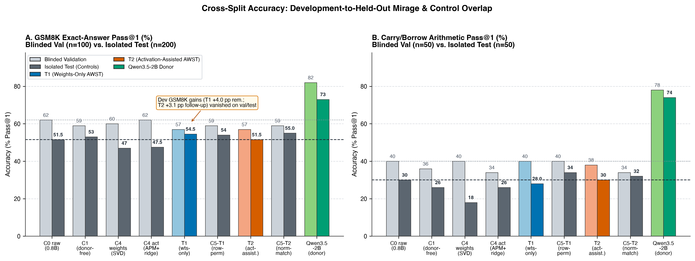
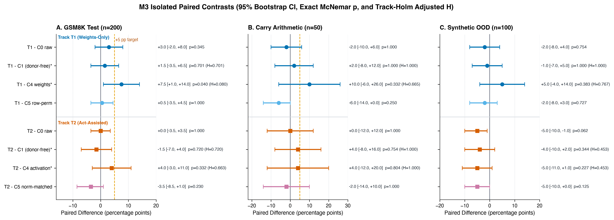

# Agentic Weight-Space Transplantation on Language Models

**Primary Investigator:** Kaiwen Du (College of Arts and Sciences, Santa Clara University) · November 27, 2026

> **Academic Research Scope Disclaimer:** This study is a non-commercial academic feasibility investigation operating exclusively on open-weight Apache-2.0 checkpoints (`Qwen/Qwen3.5-0.8B` and `Qwen/Qwen3.5-2B`). It does not perform knowledge distillation or develop models intended to compete with frontier model providers; automated editors operate strictly between pinned open-weight checkpoints.

---

## Abstract

Recent work shows that AI agents can inspect a language model's weights and make targeted edits without training. We test whether an agent can go further and *transplant* a learned capability from a larger donor model (`Qwen/Qwen3.5-2B`) into a smaller, fixed-architecture recipient (`Qwen/Qwen3.5-0.8B`) with zero gradient updates. We call this **Agentic Weight-Space Transplantation (AWST)**.

In this preregistered feasibility study targeting grade-school math, we compare two separate approaches: a **weights-only** track (`T1`, no donor forward passes) and an **activation-assisted** track (`T2`, bounded donor probing). We evaluate both against unedited, donor-free, random, conventional algorithmic, and shuffled-donor controls under a loop-free evaluation protocol. On isolated held-out benchmarks (GSM8K, synthetic arithmetic, and out-of-distribution templates), neither frozen single-session edit met our preregistered success criteria. `T1` (editing 10 digit embeddings) reached 54.5% on GSM8K versus 51.5% for the unedited model (`p = 0.345`) and did not outperform donor-free or shuffled-donor controls; `T2` (editing 2 Gated DeltaNet decay scalars) stayed at 51.5% (`p = 1.000`) and dropped on out-of-distribution items. In contrast, unaligned donor copying caused a sharp 20-point out-of-distribution collapse and worse prose perplexity, whereas aligned or sparse edits avoided this damage. We also verify bit-exact selective weight fetching over HTTP 206 byte-range requests (a 9,893x reduction in downloaded bytes). Overall, these single-session strategies fell short of genuine math transfer, though our findings do not rule out future multi-session or denser methods.

---

## 1. Introduction

Transferring specialized capabilities from large pretrained language models into compact on-device models ordinarily requires gradient-based fine-tuning, knowledge distillation, or large-scale activation-driven pruning and merging [@fan2026apm; @cui2026transport]. Recent work on **Weight-Space Programming (WSP)** demonstrates that frontier reasoning models can directly inspect serialized weight matrices, write interpretable weight programs, and execute surgical parameter edits that alter downstream behavior [@takehi2026sparks; @li2026weightcode]. In the motivating case study, Takehi et al. [@takehi2026sparks] reported raising `Qwen3.5-0.8B` GSM8K accuracy from `13.8%` to `67.1%` by subtracting a single vector direction across `131,072` MLP entries (`0.016%` of parameters).

Yet single-model WSP repairs primarily *unblock* latent capabilities by suppressing repetitive reasoning loops rather than importing missing circuits [@takehi2026sparks]. Moreover, follow-up replication work warns that frontier LLMs succeed most reliably when reading or writing shallow input-layer representations rather than deep internal algorithms [@goworek2026replicating], and that standard empirically risk-minimized (ERM) checkpoints are often brittle under direct weight perturbation unless trained specifically for editability [@ropinski2026editready]. Whether an autonomous AI programmer can extend WSP across model boundaries, identifying a stronger capability in a larger *donor* checkpoint, resolving hidden-dimension and basis mismatches, and transplanting that capability into a *recipient* without gradient descent, remains untested under rigorous controls.

We investigate five research questions for AWST:

- **RQ1 (Primary feasibility):** Can an AI agent selectively identify, adapt, and transplant grade-school math reasoning from a larger donor (`Qwen/Qwen3.5-2B`) into a smaller fixed-architecture recipient (`Qwen/Qwen3.5-0.8B`) without gradient-based training?
- **RQ2 (Agent vs. algorithm):** Does agent-directed transplantation (`T1`, `T2`) outperform matched conventional algorithmic transfer (`C4_weights`, `C4_act`)?
- **RQ3 (Donor vs. self-repair):** Does donor access outperform donor-free agent weight editing of the recipient alone (`C1`)?
- **RQ4 (Selective remote weight access):** Can bounded HTTP `206` byte-range requests fetch and verify target weight slices without downloading full multi-gigabyte model shards?
- **RQ5 (Exploratory agent comparison):** How do two frontier agent harnesses (`GPT-6.2 Astra` and `Gemini 4 Neon`) perform on a controlled synthetic weight-space competency suite?

To pass our preregistered feasibility bar, a transplanted checkpoint had to gain at least `+5 percentage points (pp)` over the unedited baseline on isolated GSM8K (and improve on multi-digit carry arithmetic), statistically beat both donor-free and conventional algorithmic controls, outperform shuffled-donor controls, generalize to out-of-distribution (`OOD`) word problems, preserve non-math instruction-following within `3 pp`, and keep the recipient architecture completely unchanged. We also evaluated whether aligned or sparse edits avoid the damage caused by unaligned donor copying and whether selective HTTP range requests can materialize exact weights at minimal bandwidth.

**Contributions and Scope.** This study makes four contributions: (1) a preregistered experimental and statistical protocol separating weights-only (`T1`) and activation-assisted (`T2`) AWST from reasoning-loop confounds, matched controls (`C0`–`C5`), and external hidden test sets; (2) an empirical evaluation showing that neither frozen single-session AWST checkpoint improved held-out math performance over unedited or shuffled-donor controls, exposing a sharp development-to-validation generalization mirage; (3) evidence that unaligned donor copying (`C3`) causes a `-20.0 pp` OOD collapse and `+16.24` perplexity increase that aligned or sparse edits avoid, alongside a verified `9,892.98x` byte reduction via HTTP `206` reads; and (4) an open, auditable failure analysis incorporating an independent statistical audit. Because we evaluated one frozen session (`N=1`) per agent track and stopped once our feasibility gate was missed, our findings provide negative evidence for these concrete single-session strategies rather than proving impossibility across future multi-session or denser methods.

---

## 2. Related Work

**Weight-Space Programming and Verification.** Takehi et al. [@takehi2026sparks] introduced Weight-Space Programming (WSP), showing GPT-6 Astra could write small policy networks and locate loop-inducing MLP directions in `Qwen3.5-0.8B` via bounded slice inspection and development forward passes, while noting cross-model circuit grafting as future work. Concurrent studies sharpen both the promise and boundaries of WSP. *WeightCode* [@li2026weightcode] shows LLMs can synthesize reusable closed-form weight-editing programs conditioned on task demonstrations, though cross-seed transfer was examined only within identical architectures. Goworek et al. [@goworek2026replicating] replicate WSP on synthetic tasks and show that LLM weight reading relies heavily on decoding input-layer weight patterns rather than mechanistic comprehension of deeper circuits, a direct warning for weights-only transplantation (`T1`). Ropinski and Kranz [@ropinski2026editready] find that standard ERM vision networks resist direct LLM edits unless pretrained with *Edit-Ready Training*, and Gross [@gross2026wspverify] combines WSP with formal verification to detect policy regressions. AWST operationalizes non-training verification via bit-exact structural invariants, `float64` reversion tests, and held-out retention suites.

**Training-Free Model Merging and Cross-Scale Transfer.** Independently trained networks occupy distinct coordinate bases and permutation symmetries, causing naive averaging or index-matched slicing to degrade performance unless neurons are aligned by weights or activations, as shown in *Git Re-Basin* [@ainsworth2023gitrebasin] and *ZipIt!* [@stoica2024zipit]. Extending to heterogeneous widths and architectures without gradient training, *Activation-Prune-Merge (APM)* [@fan2026apm] prunes salient donor dimensions from task-conditioned activation maps and merges them into smaller recipients, while *Transport and Merge* [@cui2026transport] computes neuron correspondences across distinct architectures via Optimal Transport over calibration activations. Consequently, training-free cross-scale transfer is not novel by itself; rather, AWST tests whether *agent-directed* inspection and closed-form adaptation can match or surpass algorithmic alignment baselines (`C4`) while preserving donor-specific utility (`T1/T2 > C5`).

**Safetensors Remote Metadata Parsing.** Hugging Face [@huggingface2026safetensors] documents inspecting Safetensors tensor headers via HTTP `Range` requests (`bytes=0-7` length prefix followed by JSON metadata). AWST evaluates whether exact HTTP `206` byte-range fetching can materialize isolated weight tensors without downloading entire multi-gigabyte checkpoints.

---

## 3. Method

### 3.1 Operational Definitions and Track Separation

Following our preregistered protocol, we define the core rules of AWST:

- **Donor (`Qwen/Qwen3.5-2B`):** Pretrained open-weight checkpoint demonstrating superior mathematical reasoning (`+21.5 pp` isolated GSM8K lead over the recipient).
- **Recipient (`Qwen/Qwen3.5-0.8B`):** Smaller fixed-architecture checkpoint whose existing parameter tensors may be updated into derived directories without changing parameter count (`873,438,784` stored entries), tensor shapes, layer count (`24` text layers), tokenizer, or runtime graph, and with zero gradient or backpropagation steps.
- **Weights-Only Track (`T1`):** The editing agent may inspect donor and recipient checkpoint metadata, summary statistics, and bounded tensor slices (`<= 200 MB` payload cap) and run recipient forward passes on development prompts, but executes **zero donor forward passes**.
- **Activation-Assisted Track (`T2`):** A strictly separate track permitting bounded donor forward passes (`<= 64` prompts) on development data alongside weight inspection. Tracks `T1` and `T2` are run in distinct agent sessions under separate manifests and compared against track-matched controls (`C4_weights` vs. `C4_act`).

### 3.2 Agent Interface and Immutable Provenance

Agents inspect checkpoints through a bounded Python toolbox that enforces byte-read budgets, forward-pass counters, and tensor-size limits so raw multi-million-entry matrices are never serialized into prompt context (see Appendix B for exact module and manifest paths). Every patch writes derived `.safetensors` shards without mutating cached donor or recipient checkpoints, verifying exact parameter counts, data types, and bit-exact SHA-256 invariance across all `153` multimodal vision tensors. Independent replay scripts verify deterministic shard reproduction and check that subtracting the `float64` delta restores the original recipient shard SHA-256 with zero differing parameters.

### 3.3 Implemented Interventions and Control Arms

All 10 arms evaluated on the isolated test suite (plus a validation noise reference and a Stage 0 loop-repair reference) are deterministic functions of pinned checkpoints and development prompts:

1. **`C0_raw` (Unmodified Recipient):** The unmodified `Qwen/Qwen3.5-0.8B` checkpoint. For calibration, we also tested `C0_loopfixed`, which applies Takehi et al.'s `p50c` loop-suppression direction across `130,188` `bfloat16` entries in layers 15 and 19 MLPs.
2. **`C1` (Donor-Free Agent WSP):** Without touching the donor, the agent spreads out the embeddings of digits `'0'`–`'9'` away from their shared centroid to sharpen numeric token contrast. Letting $R \in \mathbb{R}^{10 \times 1024}$ denote the 10 digit rows and $Z = R - \bar{R}$, `C1` writes $\text{BF16}(R + a Z)$ with development-screened radius $a = 1/32$.
3. **`T1` (Weights-Only AWST):** Without running the donor model, the agent reshapes the recipient's 10 digit embeddings so their cosine similarities to 30 fixed math anchor tokens (spelled digits, operators, and math words) mimic the donor's layout. Let $A_d \in \mathbb{R}^{30 \times 2048}$ and $A_r \in \mathbb{R}^{30 \times 1024}$ be centered, row-normalized anchor matrices, and $C = Z A^\top / \|Z\|_F \in \mathbb{R}^{10 \times 30}$ denote normalized digit-to-anchor similarity tables. Solving the 30-dimensional ridge system in `float64`:
   $$F = \operatorname{center\_rows}\!\left((C_d - C_r)\left(A_r A_r^\top + \frac{1}{8} I\right)^{-1} A_r\right), \quad R' = \operatorname{BF16}\!\left(R_r + a \|Z_r\|_F \frac{F}{\|F\|_F}\right)$$
   maps the donor's relative digit-anchor geometry into the recipient's native embedding space. Development screening selected radius $a = 1/32$ over $1/8$ (`19/40` vs. `17/40` on the 40-item screen), even though $a=1/8$ reduced anchor alignment error further (`0.054` vs. `0.152` from `0.185`).
4. **`T2` (Activation-Assisted AWST):** Using `56` donor forward passes on development prompts, the agent probes mid-to-late Gated DeltaNet linear-attention heads (layers `8..23`) and transfers two recurrent decay scalars at the top-ranked site. Write-gate and log-decay correlation plus numeric-token selectivity shortlisted `(layer 14, head 5)` and `(layer 13, head 12)`, and signed ablation gap selected **Layer 13, Head 12**. However, ablating that head in the `2B` donor slightly *increased* first-digit logit margin (`+0.0208` on GSM8K probes, `0.0` on carry probes), offering little causal evidence that the head is necessary. `T2` blends the donor's two decay scalars (`A_log` and `dt_bias`) at head `12` plus a median numeric-token offset (`+0.064`) with screened strength `s = 0.5` over `1.0`, editing `2` parameters and shifting estimated memory half-life from `26.66` to `26.22` steps (donor: `25.76`).
5. **`C4_weights` (Conventional Weights-Only Baseline):** Aligns donor and recipient hidden spaces via orthogonal Procrustes on `16,384` shared embedding rows, prunes donor MLP neurons (`6144 -> 3584`) by weight-product magnitude, pairs neurons via Hungarian cosine matching, and blends into layers `8..23` MLPs (`alpha = 0.05`).
6. **`C4_act` (Conventional Activation-Assisted Baseline):** Uses `32` development prompts to fit ridge input/output projections ($\lambda = 10^{-2}$), ranks and matches donor MLP neurons using mean activation magnitude and cross-model correlation, and blends into layers `8..23` MLPs (`alpha = 0.02`).
7. **`C2` (Random Recipient Noise, Validation Reference):** Adds Gaussian noise to layers `8..23` MLPs scaled to match the per-tensor edit norm of `C4_weights`.
8. **`C3` (Random Unaligned Donor Slice):** Copies random unaligned neuron subsets from donor `layers 8..23` MLPs, rescales to recipient norms, and blends at `alpha = 0.05`.
9. **`C5` (Shuffled-Donor Controls):** Tests whether gains depend on authentic donor structure rather than perturbation magnitude by running the exact `T1` recipe on randomly permuted donor embedding rows (`C5_T1_rowperm`) and the exact `T2` recipe with randomized donor decay directions, both raw (`C5_T2_perm`) and rescaled to match `T2`'s exact edit norm at Layer 13, Head 12 (`C5_T2_norm_matched`).

### 3.4 Remote Selective Safetensors Retrieval

To test whether a weights-only agent can fetch specific donor tensors without downloading full multi-gigabyte shards, we built a strict HTTP `Range` client that reads the 8-byte header-length prefix (`bytes=0-7`), parses the JSON metadata header (`bytes=8-59847`), and fetches only the exact tensor byte spans, requiring HTTP `206 Partial Content` responses and aborting on full-body HTTP `200` responses.

---

## 4. Experimental Setup

**Harness Roles and Workflow Isolation.** Research coordination, evaluation infrastructure, baseline and control implementations (`C0`, `C2`, `C3`, `C4`, `C5`), and independent replay and statistical verification were executed in Google Antigravity (`Gemini 4 Neon`, thinking effort: high). Weight transplantation trials (`T1`, `T2`) and the independent final statistical audit were performed by Codex (`GPT-6.2 Astra`, reasoning effort: max) via self-contained researcher-mediated manual handoffs with development-only visibility and separate track manifests.

**Checkpoints, Hardware, and Runtime.** All inference and evaluation ran locally on an Apple M4 Max (36 GiB unified memory, 14 CPU cores) in PyTorch MPS `bfloat16`, using `18 GB` total local cache (`< 30 GB` cap). Both `Qwen/Qwen3.5-0.8B` and `Qwen/Qwen3.5-2B` share `24` text layers (`3:1` Gated DeltaNet + Full Attention, `head_dim=256`, `vocab_size=248320`, tied embeddings), differing in hidden width (`1024` vs `2048`) and MLP width (`3584` vs `6144`). Pinned commit revisions, SHA-256 digests, software versions, and stored-vs.-runtime parameter counts (`873,438,784` stored vs. `852,985,920` active runtime parameters, omitting 15 unused multi-token-prediction tensors) are recorded in Appendix A.

**Eliminating Reasoning-Loop Confounds.** In calibration tests, enabling thinking mode (`enable_thinking=True`, `2,048` tokens, sampling without `presence_penalty=1.5` or 32K context) caused severe repetitive looping in `0.8B` (`95.0%` loops in `C0_raw` and `75.0%` in `C0_loopfixed`, with `25.0%` and `30.0%` GSM8K accuracy and `100%` truncation). Switching to greedy no-thinking decoding (`enable_thinking=False`, `max_new_tokens=1024`) cut `C0_raw` GSM8K loops to `2.0%`, lifted validation accuracy to `62.0%` (beating `C0_loopfixed`'s `56.0%`), ran roughly `5x` faster (`109.4 tok/s`), and preserved a large donor lead (`+20.0 pp` GSM8K, `+38.0 pp` carry arithmetic). We therefore froze this greedy no-thinking protocol for all main experiments.

**Datasets and External Test Isolation.** Our deterministic synthetic arithmetic suite tests three sub-skills (`carry_add_sub`: 3–5 digit addition and subtraction with `>= 2` carries/borrows; `mult_2x2_3x1`; `word_2step`) alongside 6 disjoint held-out OOD phrasing templates (`n=100`). Public GSM8K training items formed our development and validation splits (`500` and `200` items). Before running the final evaluation, all 10 checkpoints and evaluation settings were frozen in git while the final test data remained strictly outside the agent-readable workspace: a seeded 200-item GSM8K test subset, a balanced 150-item synthetic test set (`50` per sub-skill), all 100 OOD items, a 30-item non-math instruction-following suite (6 categories `x` 5 items), and teacher-forced perplexity across 10 original English prose passages (`557` predicted tokens).

**Parsing and Statistical Analysis.** Answers are extracted deterministically checking `\boxed{...}`, `#### ...`, `"final answer is/:"`, and a last-number fallback, alongside truncation (`>= 1024` tokens) and n-gram loop checks. Paired comparisons report exact percentage-point differences, `10,000`-resample paired bootstrap `95%` confidence intervals, exact two-sided McNemar `p`-values, and separate per-track Holm-Bonferroni adjustments (`{T1 vs C1, T1 vs C4_weights}` and `{T2 vs C1, T2 vs C4_act}`).

---

## 5. Results

### 5.1 Calibration Reference, Remote Range Retrieval, and RQ5 Competency

| Evaluation / Metric | `C0_raw` (`0.8B`) | `C0_loopfixed` (`p50c`) | `Qwen3.5-2B` (Donor) | Notes / Reference |
|---|---:|---:|---:|---|
| `gsm8k_val` (`n=100`, `nothink 1024`) | `62.0%` | `56.0%` | `82.0%` (`+20.0 pp`) | Calibration baseline |
| `carry_add_sub` (`n=50`, `nothink 1024`) | `40.0%` | `30.0%` | `78.0%` (`+38.0 pp`) | Primary synthetic diagnostic |
| `mult_2x2_3x1` / `word_2step` (`n=50` ea.) | `68.0%` / `90.0%` | `62.0%` / `92.0%` | `86.0%` / `100.0%` | `word_2step` at ceiling |
| `think 2048` GSM8K (`n=20`, no `pres_pen`) | `25.0%` (`95%` loop) | `30.0%` (`75%` loop) | -- | Both `100%` truncated (`103–104 tok/s`) |
| `RQ5` Toy Network Competency (`Tasks A–C`) | Neon: `3/3` (`1.0` agr.) | Astra: `3/3` (`1.0` agr.) | -- | Astra `$1.1003` shadow / `$0.00` API |
| HTTP `206` Selective Retrieval (`Qwen 0.8B`) | `176,584` / `1,746,942,600` B | **`9,892.98x` reduction** | `bit_exact_match: true` | Verified `input_layernorm` + `down_proj` slice |

**Table 1.** Calibration baselines, exploratory `RQ5` synthetic toy-network comparison (with disclosed aggregate-score visibility caveat before Astra's session), and HTTP `206` selective Safetensors verification.

Both `Gemini 4 Neon` and `GPT-6.2 Astra` achieved `3/3` (`1.0` functional agreement) on the deterministic `RQ5` toy-network suite (weight construction, affine parameter recovery, and corruption localization) in single sessions, confirming basic tool literacy without predicting real-LLM transplantation outcomes. Meanwhile, selective HTTP `206` reads reduced transferred bytes nearly four orders of magnitude (`9,892.98x`, `1` cache hit) while matching local tensors bit-for-bit, establishing retrieval feasibility.

### 5.2 Development-to-Validation Generalization Mirage

During development tuning, both agent tracks appeared weakly promising on GSM8K: on the `n=480` disjoint GSM8K development remainder, `T1` solved `273/480` (`56.9%`) vs. `254/480` (`52.9%`) for `C0_raw` (`+4.0 pp`, `38` newly correct / `19` regressed) while slipping slightly on carry remainder (`99/280` vs. `103/280`, `-1.4 pp`); on the `n=64` `T2` follow-up slice, `T2` solved `38/64` (`59.4%`) vs. `36/64` (`56.2%`) for `C0_raw` (`+3.1 pp [-3.1, +9.4]`) and `27/64` (`42.2%`) vs. `26/64` (`40.6%`) on carry (`+1.6 pp [-7.8, +10.9]`).

On blinded validation (`n=100` GSM8K, `n=50` carry/subskill), every gain disappeared (**Figure 1**):

- **`T1` (Weights-Only):** `57.0%` GSM8K (`-5.0 pp [-13.0, +2.0]` vs `C0_raw` `62.0%`, `p = 0.302`) and `40.0%` carry (`0.0 pp`), trailing or matching `C1` (`59.0%` / `36.0%`), `C4_weights` (`60.0%` / `40.0%`), `C5_elem` (`56.0%` / `32.0%`), and `C5_rowperm` (`59.0%` / `40.0%`).
- **`T2` (Activation-Assisted):** `57.0%` GSM8K (`-5.0 pp [-11.0, +1.0]` vs `C0_raw`, `p = 0.180`) and `38.0%` carry (`-2.0 pp`), trailing or matching `C4_act` (`62.0%` / `34.0%`), `C5_perm` (`57.0%` / `34.0%`), and `C5_norm_matched` (`59.0%` / `34.0%`). Meanwhile, `C2` scored `63.0%` / `36.0%` and `C3` dropped to `55.0%` GSM8K / `40.0%` carry.

Because both tracks showed zero held-out validation advantage, we froze our candidate checkpoints and proceeded directly to isolated confirmatory testing rather than scaling to larger models.

**Figure 1.** GSM8K and carry/borrow pass@1 across blinded validation and isolated confirmatory test. Development GSM8K gains for `T1` and `T2` failed to transfer, and both frozen AWST checkpoints overlapped unedited `C0_raw` and shuffled-donor `C5` controls while `Qwen3.5-2B` maintained a `+21.5 pp` to `+44.0 pp` isolated lead.

### 5.3 Isolated Confirmatory Evaluation Scorecard

In isolated confirmatory evaluation (**Table 2**, **Table 3**, **Figures 2–3**), the donor model (`Qwen3.5-2B`) maintained a large lead over `C0_raw` (`+21.5 pp` on `gsm8k_test`, `p < 1e-7`; `+44.0 pp` on `carry_add_sub`, `p = 2.74e-5`). Across the nine `0.8B`-architecture arms, neither `T1` (`54.5%` GSM8K, `28.0%` carry, `77.0%` OOD) nor `T2` (`51.5%` GSM8K, `30.0%` carry, `74.0%` OOD) outperformed donor-free `C1` (`53.0%` GSM8K), algorithmic baselines `C4_weights`/`C4_act` after Holm correction (`p = 0.080` and `p = 0.6635`), or shuffled-donor `C5` controls (`54.0%` and `55.0%` GSM8K). Dense algorithmic transfer slightly degraded both GSM8K (`47.0%` and `47.5%`) and prose perplexity (`73.86` and `66.50` vs. `62.63` baseline), whereas unaligned random donor copying (`C3`) suffered a sharp `-20.0 pp` OOD failure (`p = 3.59e-5`) and rose to `78.87` prose perplexity.

| Arm | `gsm8k_test` (`n=200`) | `carry` (`n=50`) | `mult` (`n=50`) | `word` (`n=50`) | `synthetic_ood` (`n=100`) | `ret_ifeval` (`n=30`) | `prose_ppl` | `tok/s` (`gsm8k`) | Changed Params (`rel_frob`) |
|---|---:|---:|---:|---:|---:|---:|---:|---:|---:|
| `C0_raw` | `51.5%` | `30.0%` | `66.0%` | `96.0%` | `79.0%` | `70.0%` (21/30) | `62.63` | `106.5` | `0` (`0`) |
| `Qwen3.5-2B` | **`73.0%`** | **`74.0%`** | **`86.0%`** | **`100.0%`** | **`81.0%`** | `66.7%` (20/30) | `41.02` | `61.3` | Reference donor |
| `C1` (`1/32` centroid) | `53.0%` | `26.0%` | `64.0%` | `98.0%` | `78.0%` | `70.0%` (21/30) | `62.63` | `101.9` | `9,097` (`3.96e-5`) |
| `C3` (random `2B` slice) | `49.5%` | `20.0%` | `60.0%` | `86.0%` | **`59.0%`** | `66.7%` (20/30) | **`78.87`** | `102.5` | `173.20M` (`1.12e-2`) |
| `C4_weights` (SVD/Hung.) | `47.0%` | `18.0%` | `72.0%` | `90.0%` | `72.0%` | `63.3%` (19/30) | `73.86` | `106.9` | `172.51M` (`1.00e-2`) |
| `C4_act` (APM+ridge) | `47.5%` | `26.0%` | `68.0%` | `94.0%` | `79.0%` | `73.3%` (22/30) | `66.50` | `106.7` | `168.33M` (`4.41e-3`) |
| **`T1` (wts-only)** | `54.5%` | `28.0%` | `66.0%` | `96.0%` | `77.0%` | `70.0%` (21/30) | `62.62` | `100.9` | `9,050` (`3.95e-5`) |
| `C5_T1_rowperm` | `54.0%` | `34.0%` | `62.0%` | `94.0%` | `79.0%` | `70.0%` (21/30) | `62.62` | `101.3` | `9,058` (`3.95e-5`) |
| **`T2` (act-assist.)** | `51.5%` | `30.0%` | `62.0%` | `98.0%` | `74.0%` | `70.0%` (21/30) | `62.47` | `101.4` | `2` (`1.77e-4`) |
| `C5_T2_norm_matched` | `55.0%` | `32.0%` | `60.0%` | `96.0%` | `79.0%` | `70.0%` (21/30) | `62.61` | `101.6` | `2` (`1.74e-4`) |

**Table 2.** Isolated 10-arm confirmatory scorecard (`nothink 1024` greedy, Apple M4 Max MPS `bfloat16`). All 9 `0.8B`-architecture arms verified identical `873,438,784` stored parameters, `153/153` frozen vision tensors, `2395.8 MB` post-evaluation MPS driver allocation (`4827.8 MB` for `2B`), `0.0%` GSM8K invalid parses, and `0` gradient steps.

| Contrast (`B - A`) | Endpoint (`n`) | Gains / Losses | Diff (pp) [`95%` Boot CI] | Exact McNemar `p` | Track Holm `p` |
|---|---|---:|---:|---:|---:|
| `Qwen3.5-2B - C0_raw` | `gsm8k_test` (`200`) | `52 / 9` | **`+21.5`** `[+14.5, +28.5]` | `< 1e-7` | -- |
| `Qwen3.5-2B - C0_raw` | `carry_add_sub` (`50`) | `25 / 3` | **`+44.0`** `[+26.0, +60.0]` | `0.000027` | -- |
| **`T1 - C0_raw`** | `gsm8k_test` (`200`) | `17 / 11` | `+3.0` `[-2.0, +8.0]` | `0.3449` | -- |
| **`T1 - C1`** *(primary)* | `gsm8k_test` (`200`) | `15 / 12` | `+1.5` `[-3.5, +6.5]` | `0.7011` | **`0.7011`** |
| **`T1 - C4_weights`** *(primary)* | `gsm8k_test` (`200`) | `31 / 16` | `+7.5` `[+1.0, +14.0]` | `0.0400` | **`0.0800`** |
| `T1 - C5_T1_rowperm` | `gsm8k_test` (`200`) | `9 / 8` | `+0.5` `[-3.5, +4.5]` | `1.0000` | -- |
| `T1 - C0_raw` | `carry_add_sub` (`50`) | `2 / 3` | `-2.0` `[-10.0, +6.0]` | `1.0000` | -- |
| `T1 - C0_raw` | `synthetic_ood` (`100`) | `4 / 6` | `-2.0` `[-8.0, +4.0]` | `0.7539` | -- |
| **`T2 - C0_raw`** | `gsm8k_test` (`200`) | `6 / 6` | `0.0` `[-3.5, +3.5]` | `1.0000` | -- |
| **`T2 - C1`** *(primary)* | `gsm8k_test` (`200`) | `14 / 17` | `-1.5` `[-7.0, +4.0]` | `0.7201` | **`0.7201`** |
| **`T2 - C4_act`** *(primary)* | `gsm8k_test` (`200`) | `30 / 22` | `+4.0` `[-3.0, +11.0]` | `0.3317` | **`0.6635`** |
| `T2 - C5_T2_norm_matched` | `gsm8k_test` (`200`) | `9 / 16` | `-3.5` `[-8.5, +1.0]` | `0.2295` | -- |
| `T2 - C0_raw` | `synthetic_ood` (`100`) | `0 / 5` | `-5.0` `[-10.0, -1.0]` | `0.0625` | -- |
| `C3 - C0_raw` (unaligned failure) | `synthetic_ood` (`100`) | `2 / 22` | **`-20.0`** `[-29.0, -11.0]` | **`0.000036`** | -- |
| `C4_weights - C3` | `synthetic_ood` (`100`) | `20 / 7` | `+13.0` `[+3.0, +23.0]` | `0.0192` | -- |
| `C4_act - C3` | `synthetic_ood` (`100`) | `23 / 3` | **`+20.0`** `[+11.0, +29.0]` | `0.000088` | -- |
| `T1 - C3` / `T2 - C3` | `synthetic_ood` (`100`) | `20/2` / `20/5` | `+18.0` / `+15.0` | `0.00012` / `0.00408` | -- |

**Table 3.** Paired confirmatory contrasts (`10,000`-resample bootstrap `95%` CIs, exact two-sided McNemar `p`, and track-isolated Holm-Bonferroni `p`). All `133` contrast-by-endpoint tables and `6` Holm families reproduced identically in an independent statistical audit.

**Figure 2.** Isolated paired contrasts (`95%` bootstrap CIs, exact McNemar `p`, and track Holm-adjusted thresholds). Neither track cleared `+5.0 pp` or outperformed matched `C1`, `C4`, or `C5` controls.

**Figure 3.** Whole-model relative Frobenius edit norm against isolated OOD accuracy (left) and 10-passage prose perplexity (right). Unaligned `C3` (`173.2M` entries, `rel_frob = 1.12e-2`) suffered `-20.0 pp` OOD degradation and `+16.24` perplexity rise, while aligned and sparse edits preserved baseline OOD and fluency behavior within noise.

### 5.4 Joint Preregistered Criteria, Resource Use, and Cost Summary

| Criterion (Preregistered Freeze) | Track `T1` (Weights-Only) | Track `T2` (Activation-Assisted) |
|---|---|---|
| Mathematical gain (`>= +5 pp` GSM8K, `> 0` carry) | **Fail** (`+3.0 pp [-2.0, +8.0]`, carry `-2.0 pp`) | **Fail** (`0.0 pp [-3.5, +3.5]`, carry `0.0 pp`) |
| Agent & algorithm advantage (`> C1, C4`, Holm) | **Fail** (`C1` `p=0.701`, `C4_w` `p=0.080`) | **Fail** (`C1` `p=0.720`, `C4_act` `p=0.663`) |
| Donor dependence (`> C5` & reversion) | **Fail** (`+0.5 pp [-3.5, +4.5]` vs `C5_T1`) | **Fail** (`-3.5 pp [-8.5, +1.0]` vs `C5_T2`) |
| Generalization (`synthetic_ood_test`) | **Fail** (`-2.0 pp [-8.0, +4.0]`) | **Fail** (`-5.0 pp [-10.0, -1.0]`, `p=0.0625`) |
| Capability retention (`ret_ifeval <= 3 pp` loss) | `0.0 pp` (`21/30` identical; sparse sample caveat) | `0.0 pp` (`21/30` identical; sparse sample caveat) |
| Structural invariants (`0` grad, `153/153` vision) | **Pass** (`873,438,784` params; `0` grad steps) | **Pass** (`873,438,784` params; `0` grad steps) |
| Device efficiency (`<= 10%` of `C0_raw` `106.5 tok/s`) | `100.9 tok/s` (`0.947x`); `2395.8 MB` post-eval MPS | `101.4 tok/s` (`0.952x`); `2395.8 MB` post-eval MPS |

**Table 4.** Evaluation of `T1` and `T2` against the preregistered joint feasibility criteria.

All local experiments and confirmatory evaluations ran at **`$0.00` in direct paid API or cloud GPU charges** within our `$200.00` ceiling, keeping local disk storage at **`18 GB`** (`< 30 GB` cap) (**Table 4**). Shadow-billed Codex usage (`GPT-6.2 Astra`, metered at live API rates of `$8/$0.40/$40` per million uncached input, cached input, and output/reasoning tokens) totaled **`$14.2912`** across all agent runs, staying within the `$20.00` pilot gate.

---

## 6. Analysis

An independent statistical and methodological audit highlighted several constraints that explain why these edits failed and qualify how broadly the results should be interpreted.

### 6.1 Why Did `T1` and `T2` Fail to Transfer Mathematical Reasoning?

Three mechanistic factors explain the negative outcome:

1. **Shallow Input-Layer Anchoring (`T1`) vs. Distributed Arithmetic Computation:** Consistent with Goworek et al.'s [@goworek2026replicating] observation that LLM programmers disproportionately anchor on input/embedding layers when donor activations are forbidden, `T1` localized its entire edit to 10 digit token rows (`embed_tokens.weight`). Multi-digit carry arithmetic and GSM8K word-problem reasoning require multi-step state propagation across middle-to-late DeltaNet, attention, and SwiGLU MLP blocks (`layers 8..23`), where donor and recipient widths (`2048` vs `1024`) and representation bases diverge. Nudging digit rows by `1/32` (`9,050` entries) barely shifted output logits, fitting noise on development prompts (`+4.0 pp` GSM8K remainder) that vanished on validation (`-5.0 pp`) and stayed indistinguishable from `C5_T1_rowperm` (`+0.5 pp`) on test.
2. **Lack of Causal Necessity in Localized Heads (`T2`):** In `T2`, routing correlation (`0.9327`) and numeric-token selectivity pointed to `layers.13.linear_attn` head 12, yet ablating that head in the `2B` donor slightly *increased* the first-digit logit margin (`+0.0208` on GSM8K probes, `0.0` on carry probes). Transplanting two decay scalars (`A_log`, `dt_bias`) at a non-necessary site reduced OOD accuracy (`0` gains, `5` losses, `-5.0 pp [-10.0, -1.0]`) and trailed `C5_T2_norm_matched` (`-3.5 pp`).
3. **The Perturbation Scale Chasm (Ultra-Sparse Agent Edits vs. Dense Alignment):** Comparing `T1`/`T2` against `C4` reveals an extreme gap in edit size: the agent edited `9,050` (`0.0010%`) or `2` (`2.3e-7%`) parameters, avoiding collateral fluency damage (`prose_ppl` `62.47`–`62.62` vs `62.63`), whereas algorithmic baselines `C4_weights`/`C4_act` edited `168M–172M` parameters (`~19%` of the model) and degraded GSM8K (`-4.5 pp`, `-4.0 pp`) and perplexity (`73.86`, `66.50`). Standard ERM `Qwen3.5-0.8B` weights [@ropinski2026editready] appear too distributed and coupled for either 2-scalar surgical edits or naive 16-layer linear projections to unlock `2B` reasoning without gradient adaptation.

### 6.2 Statistical Uncertainty at `n=200`

Because our `n=200` GSM8K test subset was sized for local runtime feasibility without a prospective power calculation, it has roughly `40%` power at `alpha=0.05` (`30%` at `alpha=0.025`) to detect a true `+5.0 pp` effect under the observed `14%` discordant rate between `T1` and `C0_raw` (`28/200` flips), and `26%` power under the `23.5%` discordance between `T1` and `C4_weights` (`47/200` flips). Practically, this means **`T1` vs. `C0_raw` (`+3.0 pp [-2.0, +8.0]`) still spans the `+5.0 pp` target** while failing Holm and shuffled-donor criteria, whereas **`T2` vs. `C0_raw` (`0.0 pp [-3.5, +3.5]`) excludes `+5.0 pp`** on these 200 items. Neither interval captures session-to-session editing variance because only one agent session (`N=1`) ran per track. Also, when flips are very sparse (such as `T2` losing `5` OOD items with `0` gains), bootstrap percentile intervals exclude zero (`[-10.0, -1.0]`) even while exact two-sided McNemar remains above `0.05` (`p = 0.0625`); reporting both prevents over-interpreting sparse differences.

### 6.3 Control Asymmetries and Contrast Decomposition

The near-threshold contrast `T1 - C4_weights` (`+7.5 pp [+1.0, +14.0]`, raw `p = 0.040`, Holm `p = 0.080`) splits into `+3.0 pp` (`T1 - C0_raw`) plus `-4.5 pp` (`C4_weights - C0_raw`, `[-11.5, +2.5]`, `p = 0.272`), so claiming `T1` superiority overstates the data. Likewise, our controls are asymmetric in scale and search scope: `C1` matched `T1`'s 10 digit rows, whereas no donor-free counterpart searched `layers.13.linear_attn` to match `T2`'s head search; `C2` served as a validation-only noise check; `C4` modified `10^4x–10^8x` more parameters than `T1`/`T2`; and `C5` used a single random seed (`seed=42`), with `C5_T2_norm_matched` testing donor direction conditional on `T2`'s chosen head rather than random heads.

### 6.4 Measurement and Isolation Caveats

1. **Isolation vs. Benchmark Exposure:** All checkpoints were frozen before the external test directory was opened. However, `Qwen3.5`'s pretraining exposure to public GSM8K is unknown, and our synthetic arithmetic templates were visible to the agent, meaning our OOD split tests novel word-problem phrasings rather than unseen arithmetic algorithms.
2. **Parser Fallback Attribution:** Across isolated GSM8K, `C0_raw`, `T1`, and `T2` logged `0.0%` unparseable outputs, `10.5%` / `10.0%` / `10.0%` truncations (`>= 1024` tokens), and `3.5%` / `5.0%` / `4.5%` loop flags. Because our parser falls back to the last extracted number on truncated answers and aggregates do not stratify accuracy by extraction method, numeric accuracy alone cannot fully separate mathematical reasoning from completion-length shifts.
3. **Scope of Unaligned Copying Damage:** `C3` failed sharply on OOD (`-20.0 pp`, `p = 3.59e-5`) and 10 prose passages (`62.63 -> 78.87`), with `C4_weights` as its closest same-layer, same-`alpha=0.05` comparator (`+13.0 pp` OOD, raw `p = 0.0192`). Because neuron selection, projection, and Hungarian matching varied together across one `C3` draw, this shows strong OOD sensitivity to unaligned MLP copying rather than isolating alignment as the sole cause.
4. **Retention and Efficiency Bounds:** On the 30-item format suite, `C0_raw`, `T1`, and `T2` passed the exact same `21/30` items; because one flip equals `3.33 pp`, a `[0, 0]` difference reflects sample discreteness rather than proving `< 3 pp` population loss across all non-math skills. In addition, GPU memory (`2395.8 MB`) was sampled post-evaluation rather than tracking mid-generation peaks, and runtime-graph equality was checked during independent checkpoint verification rather than re-hashed during final evaluation.

### 6.5 Compute and Time Comparison Against Fine-Tuning and Distillation

Although traditional fine-tuning or sequence distillation was outside our training-free scope and not empirically executed here, our measured resource ledgers expose an important practical trade-off: **"training-free" AWST is neither compute-free nor faster than lightweight gradient adaptation.** Across one session per track (`N=1`), development trials consumed **`9,997.74 s` (~2h 47m)** on M4 Max MPS for `T1` (`1,088,865` recipient forward passes across `C0`/`C1`/`T1`, plus `$6.0415` Codex shadow cost) and **`2,240.48 s` (~37 min)** for `T2` (`246,175` recipient forwards plus `56` donor prefills, plus `$5.9884` Codex shadow cost), totaling roughly **3.4 hours** of sequential autoregressive decoding (`>1.33M` passes) and **\$12.03 in shadow agent spend** solely to screen 2–3 candidates per track. Because evaluation-in-the-loop generates one token at a time, it is strictly memory-bandwidth-bound, whereas teacher-forced SFT/LoRA fine-tuning over the same `800` development items processes full sequences in parallel across far fewer steps and incurs `$0` agent token fees. If a reliable AWST mechanism were discovered, its distinct advantages would instead lie in **zero optimizer memory overhead**, **zero adapter inference latency (`1.00x` runtime graph)**, and **`9,892.98x` selective remote tensor retrieval** without hosting a huge donor locally.

### 6.6 Agent Comparison Scope (`RQ5`: `Gemini 4 Neon` vs. `GPT-6.2 Astra`)

On the exploratory `RQ5` deterministic toy-network suite, both `Gemini 4 Neon` (Google Antigravity, thinking effort: high) and `GPT-6.2 Astra` (Codex, reasoning effort: max) achieved **`3/3` (`1.0` functional agreement)** across Tasks A–C in single sessions, with Astra solving Task B via explicit coordinate identity `[I_8; 0] + [M, 0]` and Task C via a `20.33x` column-norm ratio at **\$1.1003 in-turn shadow cost** (`490,523` tokens, `$0.00` direct API). However, **these results do not constitute a head-to-head comparison of Neon versus Astra as real-LLM transplanters**: only `GPT-6.2 Astra` executed real-LLM weight transplantation (`T1`, `T2`), whereas `Gemini 4 Neon` served strictly as coordinator, baseline implementer, and independent verifier. Furthermore, `RQ5` ran `N=1` session per agent, Astra's session had prior visibility of Neon's `3/3` aggregate score, and Antigravity's subagent lacked comparable token billing. A definitive comparison would require isolated, equal-budget LLM editing sessions across multiple independent replicates.

---

## 7. Limitations, Safety, Licensing, and Future Work

**Key Limitations.** First, because our `2B -> 0.8B` feasibility gate was not met, we stopped before testing larger donors or cross-family transfer; those regimes remain open. Second, each track ran a single agent session (`N=1`) instead of `>= 5` independent sessions, precluding estimates of cross-session variance. Third, all evaluations used `enable_thinking=False` at `1,024` tokens; thinking-mode transfer under `vLLM presence_penalty=1.5` and `32K` context was not attempted.

**Safety and Licensing.** All evaluated checkpoints carry permissive Apache 2.0 licenses, no unapproved model weights were downloaded or uploaded, zero hidden test strings entered version control, and zero safety guardrails were weakened (`ret_ifeval` non-math constraints held unchanged).

**Future Work.** Promising next directions include: (1) investigating the intermediate regime between 2-scalar edits and 170M-parameter dense projection, such as low-rank subspace or multi-layer MLP/attention circuit grafting conditioned on positive causal ablation necessity (`drop > 0`); (2) pretraining or adapting small recipients with *Edit-Ready* objectives [@ropinski2026editready]; (3) running `>= 5` independent multi-session replicates with prospective power calculations; and (4) hardening frozen evaluators with cryptographic log-to-manifest binding and parse-method-stratified audits.

---

## 8. Conclusion

Across a preregistered, controlled evaluation of `Qwen/Qwen3.5-2B -> Qwen/Qwen3.5-0.8B`, neither single-session AWST track achieved genuine gradient-free transfer of mathematical reasoning. Weights-only `T1` (`+3.0 pp` on GSM8K, `-2.0 pp` on carry arithmetic) remained inconclusive on absolute effect size while failing to beat donor-free, algorithmic, or shuffled-donor controls, and activation-assisted `T2` (`0.0 pp` on GSM8K, `-5.0 pp` on OOD) produced a clear negative outcome on the evaluated checkpoint. Meanwhile, dense algorithmic alignment (`C4`) slightly hurt GSM8K and prose fluency, and naive unaligned donor copying (`C3`) triggered a severe `-20.0 pp` OOD collapse and `+16.24` perplexity rise that aligned and sparse edits avoided.

On the infrastructure side, selective HTTP `206` byte-range retrieval reliably fetched target tensors bit-for-bit with a `9,892.98x` reduction in downloaded bytes, and both frontier harnesses passed our synthetic toy-network competency check despite failing to generalize to real-LLM circuit transplantation. Together, these findings show that shallow embedding nudges and non-necessary scalar decay transfers fall short in standard ERM language models, pointing future work toward causally verified intermediate-rank circuit edits and edit-ready model pretraining.

---

## References

1. `takehi2026sparks`: R. Takehi, J. Teoh, A. Zhang, & O. Khattab (2026). *Sparks of Weight-Space Programming: LLMs Can Natively Read and Write Neural Network Weights.* MIT CSAIL. `https://rikiyat.github.io/blog/weight-space-programming/`
2. `fan2026apm`: J. Fan, S. Chen, Y. Hou, A. Zhang, & H. Xie (2026). *Training-Free Knowledge Transfer Across Model Scales through Activation-Guided Pruning.* `arXiv:2608.13596`.
3. `cui2026transport`: C. Cui, B. Yang, F. Shen, Y. Chen, J. Zheng, & X. Wang (2026). *Transport and Merge: Cross-Architecture Merging for Large Language Models.* `arXiv:2602.05495`.
4. `li2026weightcode`: B. Li et al. (2026). *WeightCode: Installing New Capabilities into Neural Networks via Weight-Space Programming.* `arXiv:2611.25476`.
5. `goworek2026replicating`: R. Goworek, A. Hickey, F. Nanni, & M. O'Reilly (2026). *Replicating and Extending Weight-Space Programming: Frontier LLMs Compile Programs into Weights and Read Input Layers.* `arXiv:2611.21449`.
6. `ainsworth2023gitrebasin`: S. K. Ainsworth, J. Hayase, & S. S. Srinivasa (2023). *Git Re-Basin: Merging Models modulo Permutation Symmetries.* ICLR 2023 (`arXiv:2209.04836`).
7. `stoica2024zipit`: G. Stoica, D. Bolya, J. Bjorner, P. Ramesh, T. Hearn, & J. Hoffman (2024). *ZipIt!: Merging Models from Different Tasks without Training.* ICLR 2024.
8. `ropinski2026editready`: T. Ropinski & S. Kranz (2026). *Training Vision Models for LLM-Driven Weight-Space Programming.* `arXiv:2611.26408`.
9. `gross2026wspverify`: D. Gross (2026). *Weight-Space Programming of Policies and Their Verification via Model Checking.* `arXiv:2611.11604`.
10. `qwen2026qwen35_08b`, `qwen2026qwen35_2b`: Qwen Team (2026). *Qwen3.5 Model Cards (`0.8B`, `2B`).* Hugging Face Hub.
11. `huggingface2026safetensors`: Hugging Face (2026). *Safetensors Metadata Parsing Documentation.*

---

## Appendix A. Pinned Reproducibility Registry

- **Base Recipient (`Qwen/Qwen3.5-0.8B`):** revision `2fc06364715b967f1860aea9cf38778875588b17`, primary shard `model.safetensors-00001-of-00001.safetensors`, SHA-256 `04b1c301231dd422b8860db31311ab2721511346a32cb1e079c4c4e5f1fe4696`, `873,438,784` stored / `852,985,920` active runtime params (`153` frozen vision tensors = `100,592,896` params; `488` stored vs. `473` runtime tensors omitting 15 `mtp.*` tensors). Pinned runtime stack: Python `3.11.16`, `torch 2.15.0`, `transformers 5.24.1`, `safetensors 0.8.0`, `datasets 5.2.0`, `scipy`, macOS `27.2.1`.
- **Donor (`Qwen/Qwen3.5-2B`):** revision `15852e8c16360a2fea060d615a32b45270f8a8fc`, primary shard SHA-256 `aa33250c4fc64891ddfaba3a314fd9542ea371843c387178b425fbcc5ed680b1`, `2,274,069,824` stored params.
- **Persistent Finalist Shard Digests (`runs/manifests/m3_frozen_checkpoint_audit.json`):**
  - `C1`: `b11f16df6de7bfb5f060789477a4e67764946f111feccd3a871d2440227ad11a`
  - `T1`: `da9ad05f9c4931477197b46581ed83653485f16763eeb7197bb9aaead2f81414`
  - `T2`: `ea5c744fe4d6627c2faefee13e2c2ad97c44f3ad012c7adc491d60290f6bb732`
  - `C4_weights`: `1ecd31aab734047054734dd4ffb3ad7a97f1464cb92531d0d23419928fa0fc8d`
  - `C4_act`: `2814219eb02445e4e74afad31d38fb0f8536be93d07b597dd2444698b6792491`
- **Dataset Digests (`data/dataset_manifest.json`):** `synthetic_dev` (`900`, `c2e41927...`), `synthetic_val` (`300`, `cd5e3b7f...`), `gsm8k_dev` (`500`, `6e2fbfa1...`), `gsm8k_val` (`200`, `4aa4ef28...`); external isolated `<external_eval_dir>/`: `synthetic_test` (`300`, `c81c7414...`), `synthetic_ood_test` (`100`, `4904d73b...`), `gsm8k_test` (`1319`, `5315f256...`, M3 sampled `n=200` via `Random(20261126)`).

## Appendix B. Frozen Prompt & Key Codex Handoff Manifests

- **Math Prompt (`src/evaluation/runner.py`):** User prompt embeds each problem verbatim with a single deterministic final-answer formatting instruction inside the `Qwen3.5` chat template rendered with `enable_thinking=False`, decoded greedily (`do_sample=False`, `max_new_tokens=1024`, `bfloat16`, batch size 1 on MPS).
- **Handoffs & Verification Artifacts:** `docs/handoffs/H001_rq6_competency_pilot.md`, `H002_stage1_awst_t1.md`, `H003_stage1_awst_t2.md`, `H004_m3_independent_review.md`; Antigravity independent reports `results/m1_stage0_baselines.json`, `m1_remote_reader_validation.json`, `m2_rq6_competency_comparison.json`, `m2_conventional_baselines.json`, `m2_h002_verification.json`, `m2_h003_verification.json`, `m3_isolated_evaluation.json`; Codex reports `runs/competency_astra/report.md`, `runs/codex_h002/report.md`, `runs/codex_h003/report.md`, `runs/codex_h004/review.md`.
